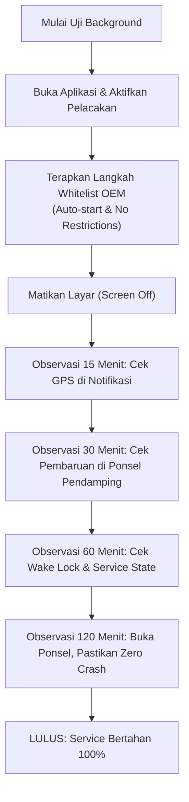

# PROTOKOL UJI VALIDASI LAPANGAN & PENGUJIAN BATERAI 4 JAM (OEM WHITELIST)
**Aplikasi Panduan Haji & Umrah Mandiri 2027**  
*Dokumen Referensi: Bagian 28.3 (TC-BAT-01), Bagian 32.1 (Fase 4), dan FR-ONB-004 SYSTEM_DESIGN_DOCUMENT.md*  
*Target Pelaksanaan: Fase 4 Roadmap (Maret – April 2027)*  
*Status Dokumen: **TERBIT / SIAP EKSEKUSI LAPANGAN***  

---

## 1. TUJUAN & DEFINITION OF DONE (DoD) FASE 4

Protokol ini disusun sebagai panduan standar operasional bagi tim teknis, relawan rombongan, dan jemaah uji coba untuk memvalidasi performa fisik aplikasi pada perangkat nyata (*real devices*) sebelum keberangkatan kloter pertama musim haji 1448 H.

### Kriteria Kelulusan (Definition of Done):
1. **Ketahanan Daya Baterai (`NFR-BAT-001` / `TC-BAT-01`):** Penurunan kapasitas baterai $\le 10\%$ selama 4 jam pelacakan aktif bergerak (rata-rata $\le 2.5\%$ per jam).
2. **Nol Pembunuhan Diam-diam (*Zero Silent Kill*):** `LocationForegroundService` tetap beroperasi 100% tanpa henti saat layar mati (*screen off*) pada seluruh varian OS vendor mayoritas jemaah Indonesia.
3. **Keterbacaan Lansia di Bawah Terik Matahari:** Seluruh teks doa, panduan manasik, dan panah kompas terbaca jelas di luar ruangan (*outdoor glare*) dengan kontras tinggi WCAG AAA ($\ge 7:1$) dan target sentuh $\ge 56\text{ dp}$.

---

## 2. MATRIKS PERANGKAT UJI LAPANGAN (DEVICE TEST MATRIX)

Pengujian wajib mencakup 4 kelompok pabrikan ponsel yang mendominasi lebih dari 85% pasar pengguna jemaah haji Indonesia:

| Kelompok OEM | Perwakilan Perangkat Uji | Sistem Operasi / ROM | Titik Kritis yang Diuji |
| :--- | :--- | :--- | :--- |
| **Xiaomi / Redmi / POCO** | Redmi Note 10 / 11 / 12, POCO X3 | MIUI 12..14 / HyperOS (Android 11–14) | Penghemat Baterai MIUI (*No Restrictions*), Izin *Auto-start*, dan Kunci *Recent Apps*. |
| **Samsung** | Galaxy A14, Galaxy A52 / A54 | One UI 5.x / 6.x (Android 13–14) | Fitur *Put unused apps to sleep* dan pendaftaran ke *Never sleeping apps*. |
| **OPPO / Realme** | Oppo A57 / Reno 8, Realme C35 / 10 | ColorOS 12..14 / Realme UI (Android 12–14) | *Startup Manager*, *Background Freeze*, dan proteksi pembunuhan aplikasi saat memori penuh. |
| **Vivo / iQOO** | Vivo Y21 / V25, iQOO Z7 | FuntouchOS 12..14 / OriginOS (Android 12–14) | Pengaturan *Konsumsi Daya Latar Belakang Tinggi* dan *Manajemen Mulai Otomatis*. |

---

## 3. PROSEDUR UJI BENCHMARK BATERAI 4 JAM (`TC-BAT-01`)

### 3.1 Prasyarat Pengujian:
1. Perangkat diisi daya hingga **100%** dan kabel pengisi daya dicabut sebelum pengujian dimulai.
2. Kartu SIM aktif dengan paket data seluler terpasang (simulasi jaringan 4G/LTE di Tanah Suci).
3. Modul pelacakan diaktifkan:
   - Penguji A bertindak sebagai jemaah target (membuka aplikasi, mengizinkan pelacakan QR).
   - Penguji B memantau dari kejauhan menggunakan mode Pelacak (*Tracker*).
4. Layanan *Foreground Service* lokasi aktif ditandai dengan notifikasi persisten di bilah status:  
   *"Panduan Haji 2027: Pelacakan Keluarga Aktif"*.
5. Konfigurasi whitelist OEM telah disetel sesuai panduan aplikasi pada menu **Pengaturan -> Ketahanan Baterai & Lacak**.

### 3.2 Langkah Eksekusi (Durasi 4 Jam):
- **Jam 0:00 (Mulai):** Catat persentase baterai awal (100%), suhu perangkat, dan waktu mulai. Kunci layar ponsel (*screen off*) dan masukkan ponsel ke dalam kantong pakaian/tas kecil jemaah.
- **Jam 0:00 – 4:00 (Simulasi Mobilitas):**
  - Penguji berjalan kaki di area terbuka (misal: area masjid agung, stadion, atau rute manasik) dengan kecepatan rata-rata $1.1\text{ m/s}$ ($3.5 - 4.5\text{ km/jam}$) untuk memicu *Movement Classifier* beralih ke interval telemetri aktif (30 detik).
  - Layar ponsel dibiarkan mati, sesekali dibuka setiap 30 menit selama 1 menit untuk membaca panduan (simulasi perilaku wajar jemaah).
- **Pencatatan Setiap 60 Menit:**
  - Jam ke-1: Catat % baterai (Target: $\ge 97.5\%$).
  - Jam ke-2: Catat % baterai (Target: $\ge 95.0\%$).
  - Jam ke-3: Catat % baterai (Target: $\ge 92.5\%$).
  - Jam ke-4: Catat % baterai (Target: $\ge 90.0\%$).

### 3.3 Perintah Diagnostik ADB (Bagi Tim Teknis):
Gunakan perintah terminal Android Debug Bridge berikut untuk mengekstrak data konsumsi daya secara deterministik:

```bash
# 1. Reset statistik baterai sebelum mulai
adb shell dumpsys batterystats --reset

# 2. Periksa status operasional Foreground Service saat layar mati
adb shell dumpsys activity service com.haji2027.feature.tracking.service.LocationTrackingService

# 3. Ekstrak rincian konsumsi daya setelah 4 jam selesai
adb shell dumpsys batterystats --charged com.haji2027.app > battery_report_4h.txt

# 4. Verifikasi bahwa wake lock tidak bocor (tidak ada partial wakelock tak berujung)
grep -E "Wake lock|Location|Uid" battery_report_4h.txt
```

---

## 4. PROSEDUR UJI ANTI-SILENT KILL OEM (BACKGROUND RETENTION TEST)

Pengujian ini memastikan sistem operasi vendor tidak memutus koneksi GPS saat jemaah sedang berjalan di terik matahari dan ponsel berada di saku:



### Kriteria Evaluasi:
- Jika pada menit ke-15 atau 30 koordinat berhenti terkirim di ponsel pendamping: **GAGAL (Silent Kill Terjadi)**. Lakukan penyesuaian whitelist pada menu vendor dan ulangi.
- Jika notifikasi status bar hilang dengan sendirinya: **GAGAL**. Pastikan flags `setOngoing(true)` aktif.
- Jika setelah 120 menit aplikasi dibuka dan tidak memuat ulang dari awal (*no cold restart*): **LULUS**.

---

## 5. PROTOKOL UJI ERGONOMI & KETERBACAAN LANSIA DI LUAR RUANGAN

Dilakukan bersama minimal 5 orang responden jemaah usia lanjut ($\ge 60\text{ tahun}$):

1. **Uji Keterbacaan Terik Sinar Matahari (Outdoor Sun Glare):**
   - Pengujian dilakukan di luar ruangan pada pukul 11:00 – 14:00 (simulasi terik Arafah/Mina).
   - Layar disetel pada mode *Auto-Brightness*.
   - Responden membaca doa tahlil Arafah (Arab 28sp & Terjemahan).
   - *Tolok ukur:* Responden dapat membaca teks tanpa memicingkan mata atau mendekatkan layar ke wajah $< 20\text{ cm}$.
2. **Uji Motorik Sentuh Target $\ge 56\text{ dp}$:**
   - Responden diminta menekan tombol [Tandai Tempat Ini] dan [Bagikan Lokasi].
   - *Tolok ukur:* Tidak terjadi salah sentuh (*mis-tap*) atau sentuhan ganda tak disengaja.
3. **Uji Kompas Panah & Kalibrasi Angka 8:**
   - Responden memegang ponsel dan berputar $360^\circ$ mengikuti panah arah hijau menuju hotel/tenda.
   - Pemicu dialog anomali magnetik dimunculkan untuk mengamati apakah responden memahami animasi instruksi putaran angka 8.

---

## 6. FORMULIR CATATAN UJI LAPANGAN (FIELD TEST REPORT SHEET)

```
========================================================================================
                          LEMBAR CATATAN UJI LAPANGAN FASE 4
========================================================================================
Tanggal Pengujian   : ___________________________
Lokasi Pengujian    : ___________________________ (Outdoor / Indoor)
Nama Penguji        : ___________________________
Model & Merk Ponsel : ___________________________ (Contoh: Xiaomi Redmi Note 11)
Versi Android & ROM : ___________________________ (Contoh: Android 13 / MIUI 14.0.5)
----------------------------------------------------------------------------------------
I. UJI BATERAI 4 JAM (TC-BAT-01)
  - Level Baterai Jam 0:00 : ______ % (Wajib 100%)
  - Level Baterai Jam 1:00 : ______ % (Penurunan: ___ %)
  - Level Baterai Jam 2:00 : ______ % (Penurunan: ___ %)
  - Level Baterai Jam 3:00 : ______ % (Penurunan: ___ %)
  - Level Baterai Jam 4:00 : ______ % (Total Penurunan: ___ %, Target: <= 10%)
  - Status Kelulusan       : [  ] LULUS (<= 10%)    [  ] GAGAL (> 10%)

II. UJI ANTI-SILENT KILL OEM
  - Menit ke-15 (Layar Mati) : [  ] Notifikasi Ada  [  ] Koordinat Terkirim
  - Menit ke-30 (Layar Mati) : [  ] Notifikasi Ada  [  ] Koordinat Terkirim
  - Menit ke-60 (Layar Mati) : [  ] Notifikasi Ada  [  ] Koordinat Terkirim
  - Menit ke-120 (Buka Layar): [  ] Service Hidup   [  ] Tidak Ada Crash/Restart
  - Status Kelulusan         : [  ] LULUS           [  ] GAGAL

III. UJI KETERBACAAN LANSIA (USIA >= 60 TAHUN)
  - Keterbacaan Teks Arab    : [  ] Sangat Jelas    [  ] Cukup Jelas    [  ] Kurang Jelas
  - Akurasi Sentuh Tombol    : [  ] 100% Tepat      [  ] Kadang Meleset [  ] Sulit Ditekan
  - Pemahaman Arah Panah     : [  ] Langsung Paham  [  ] Butuh Bantuan
========================================================================================
Tanda Tangan Penguji :                                 Tanda Tangan Penanggung Jawab :

(____________________)                                (_____________________________)
```
