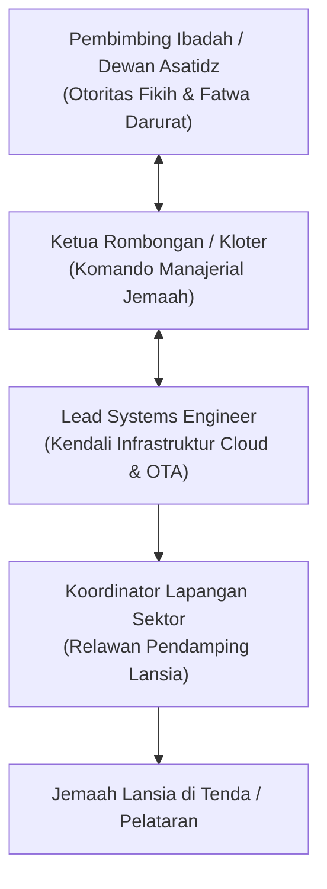

# BUKU PANDUAN OPERASIONAL MUSIM HAJI 1448 H (OPERATIONAL RUNBOOK 2027)
**Aplikasi Panduan Haji 2027 (Fase 6 & Fase 7 Roadmap)**  
*Dokumen Referensi: Bagian 37, 38, 40 SYSTEM_DESIGN_DOCUMENT.md dan UU PDP No. 27/2022*  
*Target Masa Operasional: Mei – Juli 2027 (Bulan Zulkaidah s.d. Muharam 1448–1449 H)*  
*Status Dokumen: **TERKUNCI & SIAP EKSEKUSI OPERASIONAL (LOCKED & READY)***  

---

## 1. RANTAI KOMANDO OPERASIONAL MUSIM HAJI

Operasional pendampingan jemaah selama berada di Arab Saudi (Madinah, Makkah, Armuzna) diatur dalam rantai komando teknis dan ibadah yang tegas:



| Peran | Penanggung Jawab | Wewenang & Tanggung Jawab Kunci |
| :--- | :--- | :--- |
| **Otoritas Fikih** | Ustadz Pembimbing Ibadah Kloter | Menetapkan fatwa darurat (misal: uzur melontar jumrah, nafar awal/tsani) dan menandatangani materi revisi OTA. |
| **Ketua Kloter** | Pimpinan Rombongan Haji | Mengarahkan jemaah dalam pergerakan kloter, pembagian kartu saku cetak, dan koordinasi jemaah terpisah. |
| **Tech Lead** | Senior Cloud & Android Engineer | Memantau kuota serverless Firebase, menindaklanjuti insiden teknis (SEV-1/SEV-2), dan menjaga *Code Freeze*. |
| **Relawan Sektor** | Tim Pendampingan Muda | Membantu jemaah lansia memindai QR pairing 5 menit dan mengkalibrasi kompas putaran angka 8 saat tiba di Mina. |

---

## 2. ATURAN PEMBEKUAN KODE MUTLAK (CODE FREEZE POLICY)

Untuk mencegah risiko regresi dan gangguan sistem saat jemaah berada di medan kritis Armuzna (Arafah, Muzdalifah, Mina):
1. **Jadwal Code Freeze:** Diberlakukan mulai **1 Zulhijah 1448 H** (sekitar pertengahan Mei 2027) hingga seluruh rangkaian kepulangan jemaah selesai.
2. **Larangan Rilis Binary APK Baru:** Dilarang keras merilis atau memaksa pembaruan berkas APK baru selama periode Armuzna (8 s.d. 13 Zulhijah).
3. **Pengecualian Perbaikan Konten (OTA Hotfix Only):** Jika terdapat kesalahan mendesak pada teks doa atau fatwa manasik, perbaikan hanya diizinkan melalui mekanisme pembaruan konten JSON OTA ([`OtaEngine.kt`](file:///mnt/data/haji/feature/settings/src/main/java/com/haji2027/feature/settings/ota/OtaEngine.kt)) dengan verifikasi hash SHA-256 yang ditandatangani ustadz penelaah.

---

## 3. PROSEDUR PENYELARASAN RU'YAH HILAL 1 ZULHIJAH ARAB SAUDI

Kalender bawaan sistem menggunakan `HijrahChronology` Umm al-Qura (`Asia/Riyadh`). Jika Mahkamah Agung Kerajaan Arab Saudi mengumumkan hasil rukyatul hilal yang berbeda $\pm 1$ hari:
1. **Pengumuman Resmi:** Tim teknis dan pembimbing ibadah memverifikasi keputusan resmi Kerajaan Arab Saudi pada malam 29 Zulkaidah.
2. **Instruksi Pengguna Tanpa Update APK:**
   - Bagikan instruksi kepada ketua regu dan grup jemaah:  
     *"Buka menu Pengaturan -> Geser Tanggal Manual (+1 atau -1 hari) -> Ketuk Simpan"*.
   - Kartu "Hari Ini" pada Beranda akan langsung menyesuaikan materi Tarwiyah, Arafah, atau Nahar secara instan tanpa perlu koneksi internet.

---

## 4. KLASIFIKASI INSIDEN & RUNBOOK RESPON CEPAT

| Tingkat | Gejala & Dampak | SLA Respon | Prosedur Penanganan Darurat |
| :--- | :--- | :---: | :--- |
| **SEV-1 (Kritis)** | Serverless Firestore down di Arafah / Kesalahan fatal pada teks rukun wukuf. | **$\le 15$ Menit** | 1. Jika backend terganggu: Modul offline-first tetap berjalan normal mandiri.<br>2. Terbitkan rilis darurat patch konten OTA.<br>3. Broadcast pengumuman panduan fisik via megaphone kloter. |
| **SEV-2 (Tinggi)** | Kegagalan pembuatan token QR / Pembaruan APK gagal dipasang pada tipe HP tertentu. | **$\le 1$ Jam** | 1. Periksa batas kuota Cloud Functions di GCP Console.<br>2. Instruksikan jemaah menggunakan panduan lembar saku fisik A4 ([`POCKET_GUIDE_CHEAT_SHEET.md`](file:///mnt/data/haji/distribution/POCKET_GUIDE_CHEAT_SHEET.md)). |
| **SEV-3 (Sedang)**| Perbedaan offset tanggal kalender / typo minor pada doa sunah tawaf. | **$\le 2$ Jam** | 1. Instruksikan fitur geser manual offset tanggal.<br>2. Jadwalkan update berkas OTA di luar jam ibadah utama. |

---

## 5. PEMANTAUAN INFRASTRUKTUR CLOUD & BATAS BIAYA (< $30/MUSIM)

Sesuai ketetapan arsitektur Bagian 39 SDD, sistem beroperasi dalam batas biaya sangat hemat:
1. **Budget Alert GCP/Firebase:**
   - Peringatan $50\%$ (USD $15.00): Notifikasi email ke Tech Lead & Bendahara.
   - Peringatan $80\%$ (USD $24.00): Evaluasi volume panggilan interval telemetri.
   - Hard Cap $100\%$ (USD $30.00): Firebase membatasi frekuensi penulisan telemetri non-kritis tanpa mematikan fungsi baca offline.
2. **Observabilitas Bebas PII (Crashlytics):**
   - Ambang batas target *Crash-Free Users* harian: $\ge 99.8\%$.
   - Dilarang keras merekam koordinat jemaah pada custom logs Crashlytics.

---

## 6. PENUTUPAN MUSIM HAJI & PENGHAPUSAN MASSAL (FASE 7 - ZERO DATA LIABILITY)

Setelah seluruh jemaah kloter kembali ke tanah air (Juli 2027), seluruh data sensitif telemetri wajib dihapus bersih guna memenuhi kewajiban **UU PDP No. 27/2022**:

### Prosedur Eksekusi Pembersihan Massal:
1. Tech Lead mengeksekusi layanan pembersihan Cloud:
   ```typescript
   import { PostHajjCleanupService } from "./postHajjCleanup.js";
   const result = await cleanupService.executeMassPurge();
   console.log(`LOKASI DIHAPUS: ${result.locationsPurged}`);
   console.log(`RELASI DIHAPUS: ${result.relationsPurged}`);
   console.log(`TOKEN DIHAPUS : ${result.tokensPurged}`);
   ```
2. **Verifikasi Hasil:**
   - Koleksi `/locations`: **0 dokumen**.
   - Koleksi `/tracking_relations`: **0 dokumen**.
   - Koleksi `/pairing_tokens`: **0 dokumen**.
3. **Penerbitan Sertifikat Pembersihan Data:** Menerbitkan laporan berita acara bahwa basis data server cloud telah kembali bersih 100% (*Zero Data Liability Certified*).
