# SYSTEM DESIGN DOCUMENT (SDD)
# APLIKASI PANDUAN HAJI 2027 (ANDROID NATIVE · OFFLINE-FIRST)

**Single Source of Truth untuk Desain Arsitektur, Implementasi, dan Operasional**  
**Versi Dokumen:** 1.0.0 (FINAL - LOCKED)  
**Status:** Approved & Ready for Implementation  
**Terakhir Diperbarui:** 24 Oktober 2026  
**Otoritas Desain:** Principal Software Architect, Senior Business Analyst, Android Engineering Lead, Security & QA Lead  
**Dokumen Sumber Terikat:** `Konsep2.md` (v2) dan `ringkasan.md` (8 Rujukan Manasik)  

---

## DAFTAR ISI LENGKAP (44 BAGIAN INTI)

1. [Document Control dan Version History](#1-document-control-dan-version-history)
2. [Executive Summary](#2-executive-summary)
3. [Product Vision dan Goals](#3-product-vision-dan-goals)
4. [Scope dan Non-goals](#4-scope-dan-non-goals)
5. [Stakeholder dan User Personas](#5-stakeholder-dan-user-personas)
6. [Requirement Analysis](#6-requirement-analysis)
7. [Functional Requirements](#7-functional-requirements)
8. [Non-functional Requirements](#8-non-functional-requirements)
9. [Use Cases dan Acceptance Criteria](#9-use-cases-dan-acceptance-criteria)
10. [Assumptions dan Constraints](#10-assumptions-dan-constraints)
11. [Open Decisions](#11-open-decisions)
12. [Risk Register](#12-risk-register)
13. [System Context dan Architecture Overview](#13-system-context-dan-architecture-overview)
14. [Architecture Decision Records (ADR)](#14-architecture-decision-records-adr)
15. [Component dan Module Design](#15-component-dan-module-design)
16. [Offline-first Architecture](#16-offline-first-architecture)
17. [Detailed Feature Design](#17-detailed-feature-design)
18. [Data Model dan Data Dictionary](#18-data-model-dan-data-dictionary)
19. [Local Database dan Content Schema](#19-local-database-dan-content-schema)
20. [Backend Architecture](#20-backend-architecture-firebase-platform)
21. [API dan Integration Contracts](#21-api-dan-integration-contracts)
22. [UI/UX Design System](#22-uiux-design-system)
23. [Information Architecture dan Navigation](#23-information-architecture-dan-navigation)
24. [Screen Specifications](#24-screen-specifications--prototipe-tekstual-ascii-wireframes)
25. [Interaction Flows](#25-interaction-flows)
26. [Content Governance dan Validation](#26-content-governance-dan-validasi-materi-ibadah)
27. [Security Architecture](#27-security-architecture)
28. [Privacy dan Compliance](#28-privacy-dan-compliance)
29. [Testing Strategy](#29-testing-strategy)
30. [Detailed Test Cases](#30-detailed-test-cases)
31. [Technical dan Security Audit](#31-technical-dan-security-audit)
32. [Implementation Roadmap](#32-implementation-roadmap)
33. [AI Coding Agent Task Breakdown](#33-ai-coding-agent-task-breakdown-thin-vertical-slices)
34. [CI/CD dan Release Pipeline](#34-cicd-dan-release-pipeline)
35. [APK Distribution](#35-apk-distribution-sideloading-architecture)
36. [Deployment Architecture](#36-deployment-architecture)
37. [Monitoring dan Incident Response](#37-monitoring-dan-incident-response)
38. [Backup dan Disaster Recovery](#38-backup-dan-disaster-recovery)
39. [Cost Estimation](#39-cost-estimation-analisis-kelayakan-biaya)
40. [Operational Runbook](#40-operational-runbook-musim-haji-2027)
41. [Requirement Traceability Matrix](#41-requirement-traceability-matrix-rtm)
42. [Glossary](#42-glossary-daftar-istilah-teknis-dan-manasik)
43. [References dan Source Register](#43-references-dan-source-register)
44. [Final Readiness Checklist](#44-final-readiness-checklist)

---

## 1. DOCUMENT CONTROL DAN VERSION HISTORY

### 1.1 Metadata Dokumen
- **Nama Dokumen:** System Design Document Aplikasi Panduan Haji 2027
- **Identifikasi Berkas:** `SYSTEM_DESIGN_DOCUMENT.md`
- **Klasifikasi:** Internal / Restricted (Tim Pengembang, Arsitek, QA, Pembimbing Ibadah)
- **Target Rilis Aplikasi:** Musim Haji 1448 H (Mei – Juni 2027)
- **Target Platform Perangkat:** Android 8.0 (API Level 26) hingga Android 15+ (API Level 35+)

### 1.2 Riwayat Revisi
| Versi | Tanggal | Penulis | Deskripsi Perubahan | Status |
| :---: | :---: | :--- | :--- | :---: |
| **0.1.0** | 24-10-2026 | Tim Arsitektur & Analis | Hasil ekstraksi awal `Konsep2.md` & `ringkasan.md` (Tahap 1). | Approved |
| **0.5.0** | 24-10-2026 | Principal Architect | Penyusunan Tahap I s.d. Tahap V (Kebutuhan, Risiko, Arsitektur, Data, API). | Approved |
| **1.0.0** | 24-10-2026 | Principal Architect | Finalisasi Tahap VI s.d. Tahap XIII (UI/UX, Validasi Fikih, Keamanan, Pengujian, Roadmap, Runbook, RTM). | **Approved & Locked** |

---

## 2. EXECUTIVE SUMMARY

Aplikasi **Panduan Haji 2027** adalah aplikasi Android native mandiri (*offline-first*) yang dirancang khusus untuk memandu jemaah haji Indonesia melewati masa persiapan, pelaksanaan ibadah umrah, puncak ibadah haji (8–13 Zulhijah 1448 H), hingga kepulangan. 

Sistem didirikan di atas **Tiga Pilar Fungsional**:
1. **Panduan Manasik Dinamis per Tanggal Hijriah:** Beranda satu layar terarah yang secara adaptif menampilkan instruksi manasik hari H berdasarkan perhitungan kalender Umm al-Qura (`HijrahChronology`) dengan fasilitas *manual date override*, checklist progres persisten, pencarian offline, dan bacaan doa multibahasa (Arab, Latin, Indonesia).
2. **Penandaan Tempat & Kompas Arah Real-Time:** Penandaan titik fisik (pintu masjid, hotel, bus, titik kumpul) berbasis perataan koordinat GPS (*GPS averaging*) dan navigasi panah arah garis lurus menggunakan fusi sensor rotasi perangkat dengan kompensasi deklinasi magnetik, beroperasi **100% tanpa internet dan tanpa server**.
3. **Pelacakan Posisi Keluarga Berbasis Persetujuan Eksplisit (*Consent-First*):** Mekanisme pasangan pelacak-dilacak melalui pemindaian QR code bertoken acak sekali pakai (*one-time token*), foreground service lokasi Android adaptif hemat daya, antrean pengiriman offline (*store-and-forward*), dan terminasi data otomatis pasca-haji.

Aplikasi didistribusikan secara langsung (*sideloading*) via berkas APK bertanda tangan melalui tautan HTTPS dan kode QR di lingkungan rombongan jemaah tanpa melewati Google Play Store, sehingga mengeliminasi friksi *closed testing* namun tetap mematuhi verifikasi pengembang Google 2026/2027.

---

## 3. PRODUCT VISION DAN GOALS

### 3.1 Pernyataan Visi Produk
> *"Menghadirkan pendamping digital manasik haji yang paling andal, sederhana, dan menenangkan hati bagi jemaah Indonesia—termasuk lansia—yang tetap berfungsi optimal saat jaringan internet terputus di tengah kepadatan jutaan jemaah, memandu arah tanpa membingungkan, dan menjaga keluarga tetap terhubung dengan privasi mutlak."*

### 3.2 Sasaran Keberhasilan Produk (Success Metrics)
1. **Keandalan Offline 100%:** Seluruh fitur panduan bacaan, checklist, pencarian materi, serta penandaan dan penunjuk arah tempat tersimpan berfungsi tanpa kegagalan ketika perangkat dalam mode pesawat (*airplane mode*).
2. **Keterbacaan dan Kemudahan Akses Lansia (Zero-Frustration UI):** Minimal 90% jemaah lansia dapat mengidentifikasi kegiatan ibadah hari ini dan mengaktifkan penunjuk arah hotel hanya dalam maksimal 2 ketukan dari layar utama.
3. **Efisiensi Baterai Ekstrem:** Layanan pelacakan lokasi latar belakang mengonsumsi kurang dari 2.5% daya baterai per jam dalam kondisi pergerakan aktif.
4. **Privasi & Keamanan Mutlak:** Zero data leak; tidak ada koordinat lokasi yang dapat diakses oleh pihak yang tidak dipindai secara eksplisit, dan seluruh data lokasi terhapus bersih otomatis pada akhir masa operasional haji.

---

## 4. SCOPE DAN NON-GOALS

### 4.1 Ruang Lingkup Versi 1.0 (In-Scope)
- Aplikasi Android Native (Kotlin + Jetpack Compose).
- Mesin kalender Hijriah Umm al-Qura dengan penyesuaian manual (+/- hari).
- Engine panduan manasik terstruktur (Hari → Kegiatan → Langkah) dengan skema JSON berversi.
- Penandaan tempat lokal dengan kategori, koordinat terstabilisasi, foto, dan catatan.
- Kompas panah arah real-time dengan indikator kejujuran akurasi sensor.
- Sistem pairing pelacakan keluarga via QR token bertempo kedaluwarsa 5 menit.
- Layanan lokasi latar belakang (*Foreground Service*) dengan notifikasi status bar persisten.
- Antrean pengiriman lokasi saat offline dan sinkronisasi otomatis saat online.
- Sistem pembaruan mandiri: pemeriksaan rilis APK baru & unduhan paket JSON konten over-the-air.
- Penghapusan akun dan data lokal/remote secara mandiri.

### 4.2 Batasan Eksplisit (Non-Goals Versi 1.0)
Sesuai ketetapan `Konsep2.md` §12, hal-hal berikut **dilarang keras** dimasukkan ke dalam ruang lingkup implementasi:
1. **Navigasi Rute Indoor & Deteksi Lantai:** Tidak membangun sistem perutean jalan kaki di dalam Masjidil Haram/Masjid Nabawi, tidak ada deteksi eskalator/lantai, dan tidak menjanjikan navigasi turn-by-turn.
2. **Aplikasi Multiplatform / iOS:** Tidak mengembangkan versi iPhone/iOS pada fase 1.0.
3. **Fitur Chatting & Panggilan Suara:** Tidak menyediakan modul obrolan teks, pesan suara, atau VoIP.
4. **Tombol Panik Darurat (SOS) Publik:** Tidak menghubungkan aplikasi ke nomor panggilan darurat kepolisian/medis Arab Saudi secara otomatis.
5. **Distribusi Google Play Store:** Tidak mempublikasikan APK ke Play Store guna menghindari kewajiban closed testing 14 hari 20 tester.

---

## 5. STAKEHOLDER DAN USER PERSONAS

### 5.1 Matriks Persona Pengguna

```
+-----------------------------------------------------------------------------------+
|                                  USER PERSONAS                                    |
+--------------------------+-----------------------------+--------------------------+
| 1. Jemaah Lansia         | 2. Jemaah Mandiri           | 3. Anggota Keluarga      |
|    - Penglihatan menurun |    - Mengatur jadwal sendiri|    - Melacak orang tua   |
|    - Membutuhkan font    |    - Menggunakan checklist  |    - Khawatir terpisah   |
|      besar & tombol 3    |    - Aktif menandai tempat  |    - Memantau via panah  |
+--------------------------+-----------------------------+--------------------------+
| 4. Pembimbing Ibadah     | 5. Pengelola Sistem (DevOps)|                          |
|    - Otoritas materi     |    - Menjaga backend & APK  |                          |
|    - Validasi fikih      |    - Monitoring kuota/biaya |                          |
+--------------------------+-----------------------------+--------------------------+
```

#### Persona 1: Haji Syamsuddin (68 Tahun) — Jemaah Lansia
- **Latar Belakang:** Berangkat bersama istri, jarang menggunakan smartphone selain telepon dan WhatsApp, mata presbiopi, mudah cemas di kerumunan padat.
- **Tujuan:** Mengetahui apa yang harus dibaca saat tawaf/sa'i tanpa harus membuka buku tebal, serta dapat kembali ke hotel atau pintu masjid tanpa tersesat.
- **Hambatan:** Teks kecil tidak terbaca tanpa kacamata; bingung membaca peta Google Maps yang penuh detail jalan; koneksi kartu roaming sering hilang.
- **Kebutuhan Aplikasi:** Tombol sangat besar, kontras tinggi, teks Arab berharakat jelas dengan terjemahan, panah arah besar penunjuk pintu keluar/hotel.

#### Persona 2: Fatimah (34 Tahun) — Jemaah Mandiri & Pelacak Keluarga
- **Latar Belakang:** Putri dari Pak Syamsuddin, melek teknologi, mendampingi orang tua selama berhaji.
- **Tujuan:** Memastikan posisi ayah dan ibunya terpantau jika terpisah di area Jamarat atau pelataran Masjidil Haram.
- **Hambatan:** Daya baterai smartphone cepat habis jika aplikasi pelacak mengaktifkan GPS secara boros; sinyal internet di Mina sangat padat (*throttled*).
- **Kebutuhan Aplikasi:** Pemindaian barcode pairing yang instan, tampilan indikator "terakhir dilihat X menit lalu", dan panah arah yang mengarah ke posisi orang tua.

#### Persona 3: Ustadz Ahmad (48 Tahun) — Pembimbing Ibadah (Content Authority)
- **Latar Belakang:** Pembimbing manasik rombongan, menguasai fikih haji mazhab Syafii dan perbandingannya.
- **Tujuan:** Memastikan jemaah rombongannya menjalankan urutan haji Tamattu' secara tertib dan tidak keliru memahami hukum dam/fidyah.
- **Kebutuhan Aplikasi:** Konten materi panduan berversi resmi dengan nomor revisi tercatat, serta catatan fleksibel terhadap perbedaan kondisi lapangan (misal nafar awal vs nafar tsani).

#### Persona 4: Ridwan (29 Tahun) — Administrator Sistem & DevOps
- **Latar Belakang:** Insinyur perangkat lunak pengelola rilis APK dan backend telemetri.
- **Tujuan:** Menjaga infrastruktur backend Firebase tetap berbiaya rendah (< $20 untuk 1 musim) dan memastikan APK sideload lolos verifikasi Play Protect di perangkat jemaah.

---

## 6. REQUIREMENT ANALYSIS

Analisis kebutuhan menguraikan seluruh fungsi dan atribut kualitas sistem menjadi unit kerja spesifik yang dapat dilacak (*traceable*) dari dokumen konsep hingga baris kode dan kasus uji.

### 6.1 Dekomposisi Sistem
Sistem dibagi menjadi 4 subsistem utama:
1. **Subsistem Panduan Manasik (Local Guide Engine):** Berjalan independen di perangkat klien, mengonsumsi data JSON terenkapsulasi, dan mengelola state checklist secara lokal.
2. **Subsistem Orientasi Spasial (Spatial Engine):** Mengolah data GPS dan magnetometer untuk perhitungan jarak dan bearing relatif tanpa komputasi awan.
3. **Subsistem Telemetri Keluarga (Family Tracking Engine):** Terdiri dari klien Android (Foreground Service & SQLite Sync Queue) dan backend Firebase (Cloud Firestore & Firebase Auth).
4. **Subsistem Distribusi & Integritas (Distribution Engine):** Menyediakan verifikasi versi aplikasi dan sinkronisasi payload materi JSON ber-hash SHA-256.

---

## 7. FUNCTIONAL REQUIREMENTS

Setiap kebutuhan fungsional memiliki ID stabil dan kriteria operasional yang jelas:

### 7.1 Kelompok A: Onboarding dan Setup (FR-ONB)
- **FR-ONB-001 (FTUX Tiga Langkah):** Aplikasi harus menyajikan alur onboarding maksimal 3 langkah dengan teks ukuran minimal 18sp dan tombol aksi setinggi minimal 56dp.
- **FR-ONB-002 (Just-In-Time Permissions):** Aplikasi tidak boleh meminta izin lokasi saat instalasi pertama kali; izin `ACCESS_FINE_LOCATION` hanya diminta saat pengguna pertama kali menekan tombol "Tempat Saya" atau "Bagikan Lokasi".
- **FR-ONB-003 (Edukasi Offline/Online):** Aplikasi harus menyajikan visualisasi transparan bahwa modul panduan dan penandaan tempat bekerja 100% tanpa internet.
- **FR-ONB-004 (Panduan Whitelist Baterai Vendor):** Aplikasi harus mendeteksi produsen perangkat (Build.MANUFACTURER) dan menyajikan panduan spesifik untuk Xiaomi (Auto-start/Battery Saver), Oppo/Realme, dan Vivo agar Foreground Service tidak dimatikan paksa.

### 7.2 Kelompok B: Panduan Manasik & Kalender Hijriah (FR-GUIDE)
- **FR-GUIDE-001 (Beranda Satu Layar 'Hari Ini'):** Beranda utama aplikasi harus menampilkan kartu ringkasan ibadah hari ini dan 3 tombol utama berukuran proporsional: [Panduan], [Tempat Saya], [Keluarga].
- **FR-GUIDE-002 (Perhitungan Hijriah Umm al-Qura):** Sistem harus mengonversi waktu UTC sistem ke kalender Hijriah menggunakan `java.time.chrono.HijrahChronology.INSTANCE`.
- **FR-GUIDE-003 (Manual Date Override):** Sistem harus menyediakan kontrol penyesuaian tanggal Hijriah (-3 hingga +3 hari) di antarmuka pengaturan untuk menyelaraskan dengan ketetapan ru'yah resmi otoritas Arab Saudi.
- **FR-GUIDE-004 (Hierarki Data Konten):** Sistem harus mengorganisasi materi dalam hirarki Hari → Kegiatan → Langkah Detail (termasuk status hukum: Rukun, Wajib, Sunah).
- **FR-GUIDE-005 (Rendering Bacaan Multilingual):** Teks doa/zikir harus disajikan dalam format:
  1. Aksara Arab (Font Amiri/Uthmani, minimal 24sp).
  2. Transliterasi Latin dengan pemenggalan kata yang mudah dibaca.
  3. Terjemahan Bahasa Indonesia.
- **FR-GUIDE-006 (Checklist Progres Persisten):** Pengguna dapat menandai langkah manasik yang telah diselesaikan. State centang tersimpan di Room Database dan tidak ter-reset oleh reboot perangkat atau pembaruan konten JSON.
- **FR-GUIDE-007 (Pencarian Cepat Offline):** Mesin pencari teks lokal harus memberikan hasil dalam waktu < 100ms untuk seluruh korpus materi tanpa koneksi internet.
- **FR-GUIDE-008 (Matriks Rujukan Larangan Ihram, Dam, & Fidyah):** Halaman khusus yang memetakan jenis pelanggaran ihram, tingkat kesengajaan (lupa/uzur/sengaja), dan alternatif fidyah/dam yang sah.
- **FR-GUIDE-009 (Pengingat Lokal / Local Alarms):** Pengguna dapat menjadwalkan alarm lokal via `AlarmManager.setExactAndAllowWhileIdle()` untuk jadwal pergerakan penting (misal: keberangkatan ke Arafah).
- **FR-GUIDE-010 (Label Versi dan Tanggal Revisi):** Setiap layar panduan harus menampilkan metadata versi konten aktif (misal: `v1.2.0 - Revisi 12 Mei 2027 oleh Ustadz Ahmad`).

### 7.3 Kelompok C: Penandaan Tempat & Kompas Arah (FR-PLACE)
- **FR-PLACE-001 (Penandaan dengan GPS Multi-Sampling):** Saat tombol "Tandai Tempat Ini" ditekan, sistem harus mengumpulkan minimal 5 sampel lokasi GPS selama 3-5 detik dan menghitung rata-rata koordinat untuk mengeliminasi lonjakan multipath.
- **FR-PLACE-002 (Metadata Tempat Tersimpan):** Tempat tersimpan wajib memuat nama tempat, kategori (Pintu Masjid, Hotel, Titik Kumpul, Terminal Bus, Lainnya), lintang, bujur, radius akurasi (meter), timestamp penyimpanan, catatan teks (opsional), dan URI foto lokal (opsional).
- **FR-PLACE-003 (Kalkulasi Jarak & Azimut Geografis):** Sistem menghitung jarak garis lurus (meter) dan sudut bearing derajat (0–359°) dari koordinat saat ini ke target menggunakan algoritma Great Circle / `Location.bearingTo()`.
- **FR-PLACE-004 (Orientasi Panah Real-Time Terkompensasi):** Panah arah harus berotasi halus sesuai perubahan azimuth kompas perangkat dengan koreksi variasi magnetik dari `GeomagneticField.getDeclination()`.
- **FR-PLACE-005 (Indikator Kejujuran Akurasi):** UI kompas wajib menampilkan status visual:
  - Hijau: Akurasi GPS <= 10 meter (Sangat Baik / Area Terbuka).
  - Kuning: Akurasi 11 - 30 meter (Sedang).
  - Merah: Akurasi > 30 meter (Buruk / Di dalam Gedung / Sinyal Terhalang).
- **FR-PLACE-006 (Deteksi Anomali Magnetik & Panduan Kalibrasi):** Jika sensor magnetometer mengembalikan status `SENSOR_STATUS_UNRELIABLE`, aplikasi wajib menampilkan dialog instruksi kalibrasi putaran angka 8.
- **FR-PLACE-007 (Disclaimer Garis Lurus):** Layar kompas wajib menampilkan teks peringatan permanen: *"Panah menunjukkan garis lurus fisik, bukan rute jalan, lorong, atau tangga."*

### 7.4 Kelompok D: Pelacakan Keluarga Berbasis Persetujuan (FR-TRACK)
- **FR-TRACK-001 (Generasi Barcode/QR Token Sekali Pakai):** Klien menghasilkan QR code yang mengenkapsulasi token kriptografis unik 256-bit dengan masa berlaku 5 menit.
- **FR-TRACK-002 (Pairing Dua Arah Terpisah):** Pemindaian QR hanya memberikan izin satu arah (pemindai melacak yang dipindai). Jika suami-istri ingin saling melacak, masing-masing pihak harus memindai QR pasangannya secara terpisah.
- **FR-TRACK-003 (Daftar Pengendali Izin / Konsensus):** Pihak yang dilacak dapat melihat daftar seluruh akun yang sedang memiliki akses melihat lokasinya dan dapat mencabut akses individu sewaktu-waktu.
- **FR-TRACK-004 (Foreground Service Lokasi Persisten):** Layanan pengiriman lokasi harus berjalan sebagai Android Foreground Service dengan notifikasi persisten bertipe `FOREGROUND_SERVICE_TYPE_LOCATION`.
- **FR-TRACK-005 (Pembaruan Lokasi Adaptif):**
  - Mode Bergerak (kecepatan > 0.5 m/s): Kirim pembaruan setiap 30–60 detik.
  - Mode Diam (kecepatan <= 0.5 m/s selama > 3 menit): Kirim pembaruan setiap 5 menit untuk menghemat baterai.
- **FR-TRACK-006 (Antrean Sinkronisasi Offline):** Jika transmisi lokasi gagal karena koneksi seluler mati, titik lokasi terakhir disimpan di antrean lokal Room (maksimal 50 sampel terbaru dengan strategi FIFO) dan dikirim seketika koneksi pulih.
- **FR-TRACK-007 (Tampilan Metadata Posisi Kerabat):** Pelacak melihat posisi target dengan panah arah, jarak meter, dan label timestamp eksplisit (misal: *"Terakhir diperbarui 4 menit lalu"*). Posisi > 30 menit ditandai berwarna abu-abu / status "Kedaluwarsa/Tidak Ada Sinyal".
- **FR-TRACK-008 (Terminasi Otomatis Musim Haji):** Layanan pelacakan otomatis berakhir pada 30 Zulhijah 1448 H, menghentikan foreground service dan memicu Cloud Function untuk menghapus seluruh relasi pelacakan di server.

### 7.5 Kelompok E: Distribusi, Pembaruan, & Pembersihan (FR-DIST)
- **FR-DIST-001 (Pemeriksaan Rilis APK Baru):** Aplikasi secara berkala mengecek berkas manifest versi rilis di server statis HTTPS dan menampilkan tombol unduh langsung jika ada rilis APK baru.
- **FR-DIST-002 (Pembaruan Konten JSON Over-the-Air):** Aplikasi dapat mengunduh berkas `content_vX.json` baru, memverifikasi integritas hash SHA-256, dan menjadikannya dataset aktif tanpa instal ulang aplikasi.
- **FR-DIST-003 (Pembersihan Data Mandiri / Reset Pabrik):** Pengguna dapat menekan tombol "Hapus Seluruh Data Saya" yang menghapus basis data Room lokal dan memanggil fungsi penghapusan dokumen pengguna di backend.

---

## 8. NON-FUNCTIONAL REQUIREMENTS (NFR)

| ID NFR | Parameter Kualitas | Spesifikasi Target & Kondisi Uji | Cara Pengukuran & Kriteria Lolos |
| :--- | :--- | :--- | :--- |
| **NFR-PERF-001** | Waktu Cold Startup | <= 1.5 detik pada perangkat Snapdragon 680 / RAM 4GB (Android 11). | Diukur via Android Vitals / Jetpack Macrobenchmark pada rilis APK release (minified). Lolos jika p90 <= 1500ms. |
| **NFR-PERF-002** | Latensi Pencarian Offline | <= 80 milidetik untuk query kata kunci pada 100+ artikel manasik. | Diuji dengan eksekusi query SQLite FTS4/Room lokal pada 50 kata kunci berbeda. Lolos jika p95 <= 80ms. |
| **NFR-BAT-001** | Konsumsi Baterai Pelacakan | <= 2.5% per jam saat Foreground Service pelacakan aktif bergerak. | Pengujian baterai menggunakan batterystats / Battery Historian selama 4 jam berjalan kaki di luar ruangan. |
| **NFR-REL-001** | Ketahanan Offline Penuh | 0% fitur panduan dan penandaan tempat yang mengalami crash saat no network. | Pengujian otomatis UI Automator dalam mode pesawat udara (Airplane Mode On). Zero unhandled exceptions. |
| **NFR-SEC-001** | Enkripsi Data in-Transit | Wajib TLS 1.3 untuk seluruh komunikasi payload telemetri dan unduhan JSON. | SSL Labs audit dan penegakan Network Security Config Android (`cleartextTrafficPermitted=false`). |
| **NFR-PRIV-001** | Kebijakan Retensi Lokasi | Riwayat lokasi di server berumur maksimal 24 jam (TTL). Hanya titik terakhir yang aktif. | Cloud Firestore TTL policy otomatis menghapus dokumen koordinat lama. Audit harian. |
| **NFR-ACC-001** | Aksesibilitas Lansia | Target sentuh tombol minimal 56x56 dp; rasio kontras teks minimal 4.5:1 (WCAG AA). | Audit otomatis Accessibility Scanner Android Studio dan verifikasi TalkBack screen reader. |
| **NFR-COMP-001** | Kompatibilitas Versi OS | Berjalan stabil pada Android 8.0 (API 26) hingga Android 15 (API 35). | Uji matriks perangkat fisik: Xiaomi Redmi 9 (Android 10), Oppo A57 (Android 12), Samsung A14 (Android 14). |
| **NFR-SIZE-001** | Ukuran Berkas APK | <= 18 MB ukuran unduhan APK rilis mandiri. | Analisis APK Analyzer Android Studio; kompresi aset gambar dan Proguard/R8 shrinking diaktifkan. |

---

## 9. USE CASES DAN ACCEPTANCE CRITERIA

### 9.1 Use Case UC-GUIDE-01: Membuka Panduan Hari Ini
- **Aktor:** Jemaah (Lansia / Umum).
- **Prasyarat:** Aplikasi terpasang, data konten JSON bawaan valid.
- **Pemicu:** Pengguna membuka aplikasi pada tanggal 9 Zulhijah.
- **Alur Utama:**
  1. Pengguna membuka aplikasi.
  2. Sistem membaca tanggal perangkat, menerapkan offset manual (jika ada), dan menghasilkan tanggal 9 Zulhijah 1448 H.
  3. Beranda menampilkan kartu utama: "Hari Ini: 9 Zulhijah — Wukuf di Arafah".
  4. Pengguna menekan tombol "Panduan Hari Ini".
  5. Sistem menampilkan urutan: Khutbah Arafah, Salat Jamak Qasar Zuhur-Asar, Wukuf, Doa & Zikir, dan Persiapan Berangkat ke Muzdalifah.
  6. Pengguna membuka rincian "Wukuf" dan melihat langkah, adab menghadap kiblat, dan teks doa.
- **Acceptance Criteria (AC-GUIDE-01.1):** Layar panduan hari ini tampil dalam waktu < 500ms dari penekanan tombol di beranda tanpa memuat koneksi jaringan apa pun.

### 9.2 Use Case UC-PLACE-02: Menandai Pintu Masjidil Haram & Navigasi Kembali
- **Aktor:** Jemaah.
- **Prasyarat:** Izin lokasi telah diberikan, pengguna berdiri di depan Pintu King Abdulaziz.
- **Pemicu:** Pengguna menekan tombol "Tandai Tempat Ini".
- **Alur Utama:**
  1. Pengguna memilih kategori "Pintu Masjid" dan mengetik "Pintu 1 - King Abdulaziz".
  2. Sistem mengumpulkan 5 sampel GPS selama 3 detik, menghitung koordinat median dengan akurasi 8 meter.
  3. Sistem menyimpan rekaman ke Room Database lokal. Dialog sukses muncul: "Tempat Berhasil Disimpan".
  4. Empat jam kemudian, setelah selesai tawaf, pengguna membuka daftar "Tempat Saya" dan memilih "Pintu 1 - King Abdulaziz".
  5. Sistem membuka layar kompas: Panah besar berputar mengarah ke pintu, disertai teks "Jarak: 340 meter (Garis Lurus)" dan indikator akurasi berwarna hijau.
  6. Pengguna berjalan mengikuti arah panah hingga jarak berkurang mendekati 10 meter.
- **Acceptance Criteria (AC-PLACE-02.1):** Jika sensor magnetometer mengalami distorsi logam tinggi, sistem wajib memunculkan banner peringatan "Kalibrasi Kompas Diperlukan" beserta animasi gerak angka 8 tanpa mematikan penunjuk jarak GPS.

### 9.3 Use Case UC-TRACK-03: Pendaftaran Pelacakan Suami-Istri via Barcode
- **Aktor:** Suami (Pihak yang Dilacak), Istri (Pelacak).
- **Prasyarat:** Kedua perangkat memiliki koneksi internet dan kamera aktif.
- **Pemicu:** Suami ingin posisinya dapat dilihat oleh istri selama di Mina.
- **Alur Utama:**
  1. Suami membuka menu "Keluarga" → memilih "Bagikan Lokasi Saya".
  2. Sistem suami meminta token sekali pakai ke server dan merender QR code dengan timer hitung mundur 5 menit.
  3. Istri membuka menu "Keluarga" → memilih "Pindai QR Kerabat".
  4. Kamera istri memindai QR suami.
  5. Sistem istri mengirimkan klaim token ke server; Cloud Function memvalidasi token belum kedaluwarsa dan mengikat relasi: `Tracker: Istri, Target: Suami`.
  6. Di HP suami muncul konfirmasi: "Istri (Fatimah) sekarang dapat melihat posisi Anda", dan Foreground Service lokasi suami aktif dengan notifikasi status bar.
  7. Di HP istri, nama suami muncul di daftar "Orang yang Saya Lacak" lengkap dengan jarak dan panah arah.
- **Acceptance Criteria (AC-TRACK-03.1):** Jika QR dipindai setelah menit ke-6 (kedaluwarsa), sistem istri wajib menampilkan pesan error eksplisit: `TOKEN_EXPIRED: Kode QR telah kedaluwarsa, silakan buat kode baru di HP pasangan.`

---

## 10. ASSUMPTIONS DAN CONSTRAINTS

### 10.1 Register Asumsi
- **ASM-TECH-01:** Pengguna membawa perangkat smartphone Android dengan layar sentuh kapasitif fungsional dan sensor GPS internal.
- **ASM-TECH-02:** Kartu SIM jemaah (roaming Indonesia atau kartu lokal Saudi seperti STC/Zain/Mobily) memiliki kuota data aktif minimal untuk pertukaran pesan telemetri teks ringan (< 5MB/minggu).
- **ASM-OPS-01:** Penanggung jawab materi fikih (Ustadz pembimbing) telah menyetujui rilis berkas konten JSON sebelum keberangkatan kloter pertama pada Mei 2027.
- **ASM-REG-01:** Kebijakan penegakan verifikasi pengembang Google di Indonesia per 30 September 2026 memungkinkan instalasi APK sideload yang ditandatangani oleh akun pengembang berstatus *Full Distribution*.

### 10.2 Batasan Arsitektural (Constraints)
- **CST-01 (Strict Zero-Cloud Dependency for Core Guide):** Modul panduan manasik dan penandaan tempat dilarang memiliki dependensi impor jaringan apa pun. Ketiadaan jaringan tidak boleh menghasilkan layar kosong atau error blocking.
- **CST-02 (Stateless Backend Telemetry):** Server backend tidak menyimpan rekaman jejak rute (*breadcrumb history*); server hanya menyimpan 1 dokumen koordinat mutakhir per pengguna (*last known location*) dengan time-to-live (TTL) 24 jam.
- **CST-03 (Single APK Architecture):** Seluruh fitur terintegrasi dalam 1 paket APK mandiri tanpa ketergantungan pada dynamic feature module download Play Store.

---

## 11. OPEN DECISIONS

Daftar keputusan terbuka yang diwariskan dari `Konsep2.md` §12 dan keputusan teknis turunan:

```
+----------------------------------------------------------------------------------------------------+
|                                    REGISTER KEPUTUSAN TERBUKA                                      |
+--------+----------------------------+-----------------------+-----------------------+--------------+
| ID     | Topik Keputusan            | Pilihan Tersedia      | Rekomendasi Arsitek   | Pengambil Kep|
+--------+----------------------------+-----------------------+-----------------------+--------------+
| OD-001 | Nama Resmi Aplikasi        | A: HajiGuide 2027     | B (Panduan Haji 2027) | Product Owner|
|        |                            | B: Panduan Haji 2027  |                       |              |
|        |                            | C: Manasik Bersama    |                       |              |
+--------+----------------------------+-----------------------+-----------------------+--------------+
| OD-002 | Penanggung Jawab Fikih     | A: Ustadz Rombongan   | A (Ustadz Rombongan)  | Pembimbing   |
|        |                            | B: Tim Gabungan Luar  |                       | Ibadah       |
+--------+----------------------------+-----------------------+-----------------------+--------------+
| OD-003 | Model Biaya & Kapasitas    | A: Gratis Murni       | A (Gratis, Firebase   | Product Owner|
|        |                            | B: Subsidi Rombongan  | Spark/Blaze Terkendali| & Bendahara  |
+--------+----------------------------+-----------------------+-----------------------+--------------+
| OD-004 | Jangkauan Distribusi       | A: Khusus Rombongan   | B (Publik via Web/QR, | Tech Lead &  |
|        |                            | B: Publik Bebas       | Google Full Acc $25)  | Product Owner|
+--------+----------------------------+-----------------------+-----------------------+--------------+
| OD-005 | Koordinat Pintu Masjid     | A: Koordinat Hardcode | B (Tanpa Preset,      | QA & Product |
|        |                            | B: Tandai Mandiri     | Jemaah Tandai Riil)   | Lead         |
+--------+----------------------------+-----------------------+-----------------------+--------------+
| OD-006 | Kepemilikan Keystore       | A: Pribadi Developer  | B (Akun Organisasi/   | Tech Lead &  |
|        |                            | B: Yayasan/Rombongan  | Lembaga Rombongan)    | Legal        |
+--------+----------------------------+-----------------------+-----------------------+--------------+
```

---

## 12. RISK REGISTER

Analisis risiko menyeluruh mencakup probabilitas (P: 1-5), dampak (D: 1-5), skor risiko (R = PxD), mitigasi preventif, dan strategi pemulihan:

| ID Risiko | Deskripsi Risiko | P | D | R | Mitigasi Preventif | Respon & Rencana Kontinjensi | Penanggung Jawab |
| :--- | :--- | :---: | :---: | :---: | :--- | :--- | :--- |
| **RSK-LOC-01** | Penurunan akurasi GPS ekstrem di dalam gedung Masjidil Haram (lonjakan puluhan meter). | 5 | 4 | **20** | Tampilkan indikator visual merah jika akurasi > 30m; instruksikan jemaah menandai pintu saat berada di pelataran luar. | Peringatan teks permanen: "Akurasi rendah karena berada di dalam bangunan". | Android Eng Lead |
| **RSK-BAT-02** | Pemutusan paksa Foreground Service oleh manajemen baterai vendor agresif (Xiaomi, Oppo, Vivo). | 4 | 4 | **16** | Sediakan modul panduan whitelist baterai di onboarding; minta izin `REQUEST_IGNORE_BATTERY_OPTIMIZATIONS`. | Tampilkan dialog deteksi jika service terhenti di latar belakang saat app dibuka kembali. | Android Eng Lead |
| **RSK-SEC-03** | Penyadapan atau pemalsuan token QR untuk melacak jemaah tanpa persetujuan sah. | 2 | 5 | **10** | Token berumur pendek (5 menit), kriptografi entropi 256-bit, sekali pakai (*single-use*), validasi Cloud Function. | Sediakan tombol satu ketukan bagi jemaah untuk mencabut izin seketika di menu "Siapa Melacak Saya". | Security Lead |
| **RSK-NET-04** | Ketiadaan koneksi internet total di Mina/Arafah selama puncak haji. | 5 | 3 | **15** | Arsitektur panduan & penandaan tempat 100% lokal SQLite/JSON. Antrean lokal untuk pengiriman lokasi tertunda. | Aplikasi tetap berfungsi penuh untuk panduan dan penandaan tempat tanpa error modal. | Architect Lead |
| **RSK-REL-05** | Kesalahan substansi materi fikih atau konflik antar-pendapat yang membingungkan jemaah. | 2 | 5 | **10** | Terapkan alur tata kelola konten: Draft → Review Ustadz → Approved. Sajikan 10 titik perbedaan secara transparan. | Fasilitas pembaruan konten darurat over-the-air via paket JSON terverifikasi tanpa rilis ulang APK. | Content Lead |
| **RSK-DIST-06**| Pemblokiran instalasi APK sideload oleh Google Play Protect karena kebijakan verifikasi 2026/2027. | 3 | 5 | **15** | Pendaftaran akun pengembang resmi Google Console (Full Distribution $25) dan pendaftaran sertifikat penandatanganan. | Sediakan panduan langkah demi langkah bergambar di halaman web unduhan untuk "Tetap Pasang / Install Anyway". | DevOps Lead |

---

## 13. SYSTEM CONTEXT DAN ARCHITECTURE OVERVIEW

### 13.1 System Context Diagram (C4 Level 1)

Diagram konteks sistem memetakan batas sistem aplikasi terhadap entitas pengguna, perangkat keras sensor, platform cloud Firebase, dan sistem distribusi mandiri:

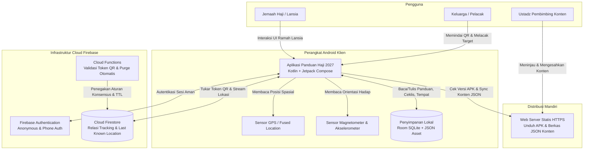

---

## 14. ARCHITECTURE DECISION RECORDS (ADR)

### ADR-001: Pemilihan Teknologi Klien — Native Android (Kotlin + Jetpack Compose)
- **Status:** Diterima (*Accepted*).
- **Konteks:** Aplikasi membutuhkan integrasi intensif dengan subsistem perangkat keras Android tingkat rendah (`SensorManager`, `GeomagneticField`, `FusedLocationProviderClient`), eksekusi latar belakang persisten (`ForegroundService` bertipe lokasi), penanganan fragmentasi vendor baterai (MIUI, ColorOS), serta rendering antarmuka modern yang sangat ringan untuk lansia.
- **Alternatif yang Dipertimbangkan:**
  1. *Flutter / Dart:* UI konsisten, namun integrasi background service lokasi pada Android 14+ sering mengalami *bridge unreliability* dan meningkatkan ukuran binary APK awal (+15MB engine overhead).
  2. *React Native:* Overhead runtime JavaScript engine, konsumsi memori lebih besar pada perangkat low-end 3GB RAM.
- **Keputusan:** Menggunakan **Native Kotlin dengan Jetpack Compose**.
- **Konsekuensi:** Akses langsung tanpa hambatan (*zero-overhead*) ke API Android SDK terbaru, binary size optimal (<18MB), rendering UI 60 FPS pada perangkat low-end, dan kemudahan pengujian komponen arsitektural Android Architecture Components.

### ADR-002: Pemilihan Backend Layanan Pelacakan — Firebase Serverless vs Self-Hosted
- **Status:** Diterima (*Accepted*).
- **Konteks:** Sistem membutuhkan backend untuk autentikasi anonim/kredensial, validasi pertukaran token QR, dan penyimpanan posisi koordinat terakhir dengan latensi rendah. Skala pengguna awal adalah 1–3 kloter rombongan (400–1.200 jemaah) dengan masa kritis hanya 40 hari per tahun.
- **Alternatif yang Dipertimbangkan:**
  1. *Self-Hosted VPS (FastAPI / Go + PostgreSQL + Redis):* Memerlukan biaya sewa server bulanan, konfigurasi pengamanan TLS/Certbot, pemeliharaan OS patch, mitigasi DDoS, dan risiko server down saat tim teknis sedang berada di Armuzna (Arafah-Muzdalifah-Mina).
  2. *Firebase Serverless (Auth, Firestore, Cloud Functions, Cloud Storage):* Terkelola penuh (*fully managed*), SLA ketersediaan 99.95%, auto-scaling elastis, keamanan data in-transit & at-rest bawaan Google Cloud, dan kuota gratis/Blaze tier yang sangat murah (< $20 untuk 1 musim haji).
- **Keputusan:** Menggunakan **Firebase Serverless Architecture** dengan enkapsulasi repositori ketat (`TrackingRepository` interface di Android klien).
- **Konsekuensi:** Mengeliminasi seluruh beban operasional infrastruktur server mandiri saat tim berada di Tanah Suci. Jika di masa depan sistem diadopsi secara nasional (100.000+ jemaah), implementasi `TrackingRepository` dapat dialihkan ke microservices mandiri tanpa mengubah kode domain aplikasi Android.

### ADR-003: Strategi Penyimpanan Konten Panduan — Dual-Layer Content Architecture
- **Status:** Diterima (*Accepted*).
- **Konteks:** Materi manasik haji terdiri dari teks terstruktur berukuran sedang (~200KB) yang harus tersedia instan sejak detik pertama instalasi, namun harus dapat diperbaiki sewaktu-waktu jika ustadz pembimbing melakukan revisi darurat tanpa mewajibkan jemaah mengunduh ulang APK 18MB.
- **Keputusan:** Menggunakan **Dual-Layer Architecture**:
  1. *Layer 1 (Bundled Assets):* Berkas `content_v1.0.0.json` tertanam di dalam APK folder `assets/`, menjadi baseline data mutlak saat aplikasi diinstal offline.
  2. *Layer 2 (OTA Overlay Cache):* Berkas `content_override.json` di direktori privat aplikasi (`context.filesDir/content/`). Jika server menyediakan rilis konten dengan nomor versi lebih tinggi dan lulus verifikasi checksum SHA-256, aplikasi otomatis memprioritaskan Layer 2.
  3. Data progres checklist dan catatan tempat tersimpan tetap disimpan di **Room SQLite Database** yang terpisah dari konten panduan, sehingga pembaruan konten tidak pernah menghapus centang progres jemaah.

---

## 15. COMPONENT DAN MODULE DESIGN

### 15.1 Modularisasi Proyek Android
Proyek dibangun dengan arsitektur multi-module proporsional untuk memisahkan domain logika dari detail implementasi platform tanpa menimbulkan overengineering:

```
+---------------------------------------------------------------------------------+
|                               GRADLE MODULE TREE                                |
+---------------------------------------------------------------------------------+
| :app                     (Application Entry, Navigation Graph, Dagger Hilt DI)  |
+---------------------------------------------------------------------------------+
| :core:designsystem       (Compose Tokens, Typography Lansia, Buttons, Colors)   |
| :core:common             (Dispatchers, Result Wrappers, Date Umm al-Qura Util)  |
| :core:database           (Room DB, Entities, DAOs for Places, Checklist, Queue) |
| :core:model              (Pure Kotlin Domain Data Classes: Place, Step, Token)  |
+---------------------------------------------------------------------------------+
| :feature:guide           (ViewModel, Screens: Beranda, Detail Manasik, Search)  |
| :feature:places          (ViewModel, Screens: MarkPlace, CompassNav, SensorMgr) |
| :feature:tracking        (ViewModel, Screens: QR Share, Pair, ForegroundService)|
| :feature:settings        (ViewModel, Screens: Hijri Offset, Battery Guide, OTA) |
+---------------------------------------------------------------------------------+
```

### 15.2 Container Diagram Aplikasi Klien (C4 Level 2)

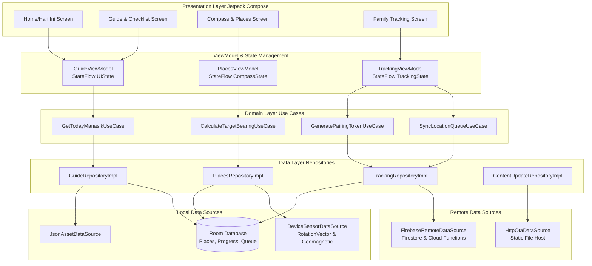

---

## 16. OFFLINE-FIRST ARCHITECTURE

Arsitektur *Offline-First* adalah kontrak inti sistem. Tidak ada satupun fungsionalitas dasar panduan ibadah atau navigasi tempat yang boleh digagalkan oleh kegagalan koneksi jaringan.

### 16.1 Matriks Klasifikasi Data

| Entitas Data | Sumber Utama | Mekanisme Penyimpanan Lokal | Kebutuhan Jaringan | Kebijakan Sinkronisasi |
| :--- | :--- | :--- | :--- | :--- |
| **Materi Panduan Manasik** | Bundled Asset JSON / OTA | JSON File Cache di memori & disk privat | Hanya saat cek pembaruan opsional | Pull satu arah, validasi hash SHA-256 |
| **Checklist & Progres Manasik**| Aksi Pengguna Klien | Room Database (`checklist_table`) | Tidak Ada (Murni Lokal) | Tidak disinkronkan ke server (Privasi) |
| **Tempat Tersimpan (Pintu/Hotel)**| Sensor GPS Klien | Room Database (`places_table`) | Tidak Ada (Murni Lokal) | Disimpan permanen di perangkat pengguna |
| **Orientasi Kompas & Panah** | Sensor Magnetometer Klien| In-Memory Flow State | Tidak Ada (Murni Lokal) | Kalkulasi matematis instan real-time |
| **Token Pendaftaran QR** | Cloud Functions / Klien | In-Memory Session Cache | Wajib Internet (Koneksi Sekali) | Token hangus dalam 5 menit / sekali pakai |
| **Telemetri Posisi Kerabat** | Cloud Firestore | In-Memory Flow + Room Buffer Queue | Wajib Internet saat transmisi | *Store-and-forward* (Antrean FIFO lokal) |

### 16.2 Alur Sinkronisasi Offline Store-and-Forward Telemetri

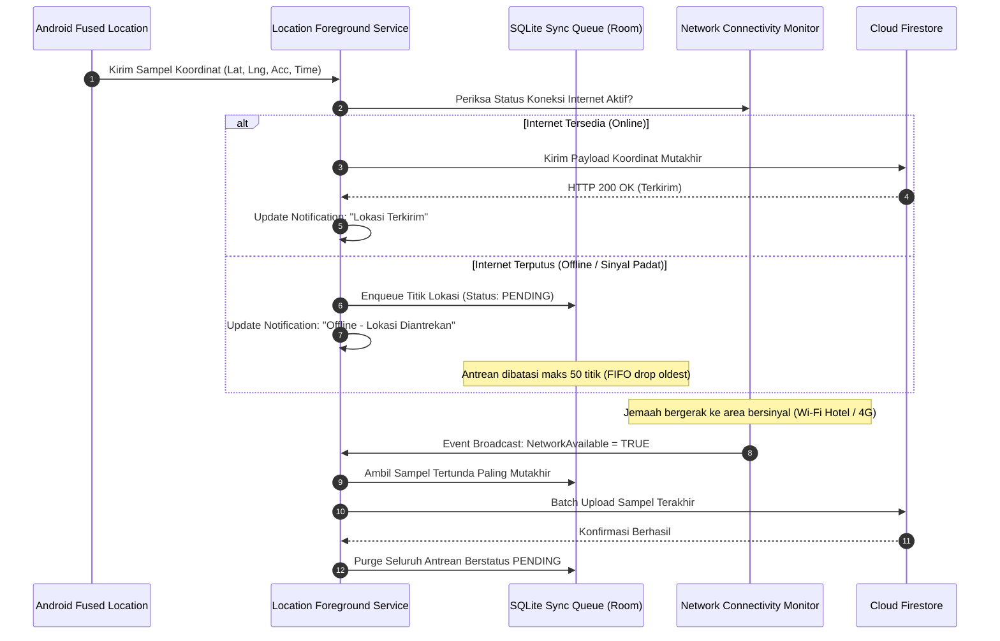

---

## 17. DETAILED FEATURE DESIGN

### 17.1 Mesin Panduan Berbasis Kalender Hijriah (Hijrah Guide Engine)

#### 17.1.1 Algoritma Kalkulasi Kalender & Date Override
Mesin panduan menghitung tanggal Hijriah lokal secara dinamis menggunakan kalender astronomi Umm al-Qura bawaan Java/Android (`java.time.chrono.HijrahChronology`) yang di-offset secara manual oleh pengguna untuk menyesuaikan hasil hisab dengan ru'yah hilal resmi Kerajaan Arab Saudi.

```kotlin
class HijriCalendarEngine(
    private val preferencesRepository: PreferencesRepository
) {
    /**
     * Menghasilkan representasi tanggal Hijriah terkompensasi manual offset.
     * Menggunakan zona waktu resmi pelaksanaan ibadah (Asia/Riyadh, UTC+3).
     */
    fun getCurrentHijriDate(): Flow<HijriDateModel> {
        return preferencesRepository.getHijriOffsetDays().map { manualOffset ->
            val saudiZone = ZoneId.of("Asia/Riyadh")
            val todayGregorian = LocalDate.now(saudiZone)
            val baseHijrahDate = HijrahChronology.INSTANCE.date(todayGregorian)
            
            // Terapkan manual offset (-3 s.d. +3 hari)
            val adjustedHijrahDate = baseHijrahDate.plus(manualOffset.toLong(), ChronoUnit.DAYS)
            
            HijriDateModel(
                dayOfMonth = adjustedHijrahDate.get(ChronoField.DAY_OF_MONTH),
                monthNumber = adjustedHijrahDate.get(ChronoField.MONTH_OF_YEAR),
                year = adjustedHijrahDate.get(ChronoField.YEAR),
                monthName = getHijriMonthName(adjustedHijrahDate.get(ChronoField.MONTH_OF_YEAR)),
                isHajjSeason = adjustedHijrahDate.get(ChronoField.MONTH_OF_YEAR) == 12,
                appliedOffsetDays = manualOffset
            )
        }
    }
}
```

#### 17.1.2 State Machine Beranda & Panduan Manasik
Siklus hidup penyajian panduan harian diatur oleh mesin status terprediksi:

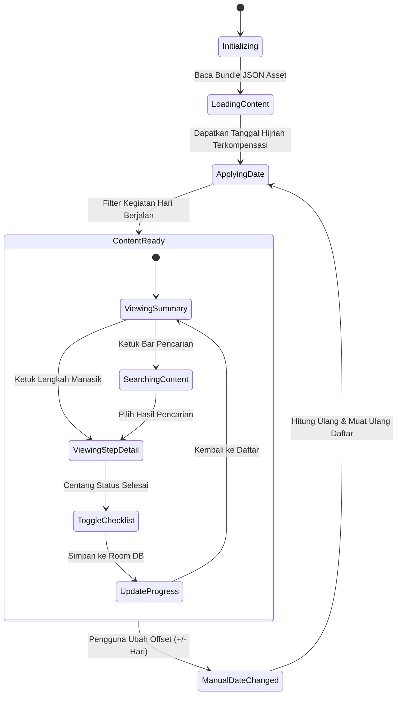

#### 17.1.3 Mesin Pencarian Lokal (Offline Full-Text Search)
Pencarian materi menggunakan tabel virtual SQLite `FTS4` di dalam Room Database. Seluruh teks judul kegiatan, langkah-langkah, bacaan doa, dan rujukan hukum diindeks secara lokal saat inisialisasi aplikasi. Query pencarian mendukung pencarian awalan (*prefix matching*) dan toleransi diakritik tanda petik.

---

### 17.2 Sistem Konten JSON Berversi & Pembaruan OTA (Over-the-Air)

#### 17.2.1 Skema Konten Terstruktur
Konten panduan diorganisasikan dalam hierarki: `Hari (Day) → Kegiatan (Activity) → Langkah (Step) → Bacaan (Reading) & Hukum (Ruling)`.

```json
{
  "$schema": "https://panduanhaji2027.org/schemas/content-v1.json",
  "version": "1.0.0",
  "revision_date": "2026-10-24",
  "approved_by": "Ustadz Pembimbing Rombongan",
  "hajj_year": 1448,
  "days": [
    {
      "day_id": "day_09_zulhijah",
      "hijri_day": 9,
      "hijri_month": 12,
      "title": "9 Zulhijah — Hari Arafah (Puncak Ibadah Haji)",
      "location": "Arafah",
      "summary": "Hari wukuf di Arafah yang merupakan rukun haji terpenting. Diisi dengan mendengarkan khutbah, salat jamak qasar Zuhur-Asar, wukuf, serta memperbanyak doa dan zikir hingga matahari terbenam.",
      "activities": [
        {
          "activity_id": "act_arafah_wukuf",
          "sequence_order": 3,
          "title": "Wukuf di Padang Arafah",
          "ruling_category": "RUKUN",
          "time_window": "Setelah zawal (Zuhur) hingga terbenam matahari",
          "location_notes": "Boleh di dalam kemah, di luar kemah, atau di atas kendaraan. Yang utama menghadap kiblat.",
          "steps": [
            {
              "step_id": "step_wukuf_01",
              "order": 1,
              "instruction": "Masuk waktu wukuf setelah matahari tergelincir (masuk waktu Zuhur). Pastikan fisik berada di dalam batas wilayah Arafah.",
              "prohibitions": ["rafats", "fusuk", "jidal", "larangan_ihram_umum"],
              "differences_note": {
                "has_ikhtilaf": false,
                "summary": "Seluruh ulama sepakat wukuf di Arafah adalah rukun haji mutlak yang tidak dapat diganti dengan dam."
              }
            },
            {
              "step_id": "step_wukuf_02",
              "order": 2,
              "instruction": "Menghadap kiblat, mengangkat kedua tangan, dan memperbanyak doa serta zikir utama hari Arafah.",
              "readings": [
                {
                  "reading_id": "read_arafah_tahlil",
                  "title": "Zikir Utama Hari Arafah",
                  "arabic_text": "لَا إِلَهَ إِلَّا اللَّهُ وَحْدَهُ لَا شَرِيكَ لَهُ، لَهُ الْمُلْكُ وَلَهُ الْحَمْدُ، وَهُوَ عَلَى كُلِّ شَيْءٍ قَدِيرٌ",
                  "latin_transliteration": "Laa ilaaha illallaahu wahdahu laa syariika lah, lahul mulku wa lahul hamdu wa huwa 'alaa kulli syai-in qadiir.",
                  "translation_id": "Tidak ada sesembahan yang berhak disembah selain Allah semata, tidak ada sekutu bagi-Nya. Milik-Nya segala kerajaan dan bagi-Nya segala pujian, dan Dia Mahakuasa atas segala sesuatu.",
                  "source_ref": "HR. Tirmidzi no. 3585, dinilai hasan."
                }
              ]
            }
          ]
        }
      ]
    }
  ]
}
```

#### 17.2.2 Alur Pembaruan Konten Over-the-Air (OTA) & Rollback Otomatis
Pembaruan materi dilakukan secara aman melalui mekanisme transaksi berkas atomik:

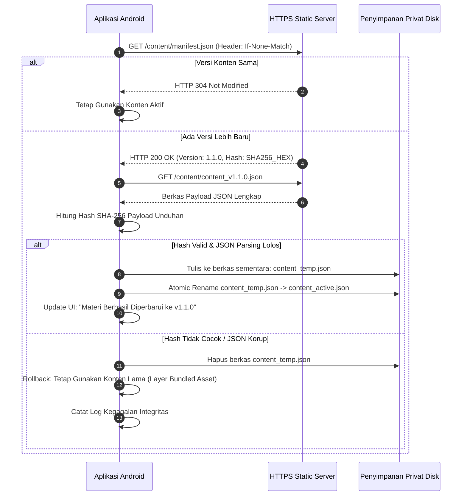

---

### 17.3 Penandaan Tempat & Navigasi Panah Spasial

#### 17.3.1 Algoritma Fusi Sensor dan Formula Penunjuk Panah
Untuk menghasilkan arah panah yang presisi dan stabil di tengah interferensi lingkungan, sistem mengintegrasikan pembacaan sensor rotasi, deklinasi magnetik, dan rumus jarak bearing geografis:

```
[Target Coordinate (Lat2, Lng2)] <-----+ (Haversine & BearingTo)
                                       |
[Current GPS (Lat1, Lng1)] ------------+ ===> Target Bearing (Tb)
                                                    |
[Sensor Rotation Vector / Mag] ========> Device Azimuth (Am)
                                                    |
[GeomagneticField Declination] ======> Declination (D) (+2.8° Makkah)
                                                    |
True Device Azimuth (At) = (Am + D + 360) % 360     |
                                                    |
Panah Relatif (Theta) = (Tb - At + 360) % 360 <-----+
```

1. **True Azimuth Perangkat ($A_t$):**
   Sudut orientasi perangkat terhadap Kutub Utara Sejati dihitung dari matriks rotasi Android yang dikoreksi oleh deklinasi magnetik lokal:
   $$A_t = (A_m + \text{declination} + 360^\circ) \pmod{360^\circ}$$
   Di mana $\text{declination}$ dihitung secara dinamis melalui `GeomagneticField(lat, lng, alt, timestamp).getDeclination()` (sekitar $+2.8^\circ$ Bujur Timur untuk kawasan Makkah/Madinah).

2. **Bearing Target Geografis ($T_b$):**
   Sudut dari posisi saat ini $(lat_1, lng_1)$ menuju tempat tersimpan $(lat_2, lng_2)$ menggunakan fungsi bola besar (*Great Circle Initial Bearing*):
   $$T_b = \text{atan2}(\sin(\Delta lng) \cdot \cos(lat_2), \cos(lat_1) \cdot \sin(lat_2) - \sin(lat_1) \cdot \cos(lat_2) \cdot \cos(\Delta lng))$$

3. **Sudut Rotasi Jarum Panah Antarmuka ($\theta$):**
   Sudut putar jarum panah Compose relatif terhadap sumbu atas layar smartphone:
   $$\theta = (T_b - A_t + 360^\circ) \pmod{360^\circ}$$

#### 17.3.2 Stabilisasi Titik dengan GPS Multi-Sampling
Saat pengguna menekan tombol "Tandai Tempat Ini", sistem tidak langsung mengambil satu sampel GPS yang rentan terhadap galat multipath. Sistem mengaktifkan *sampling loop*:
- Mengumpulkan 5 sampel koordinat berturut-turut dengan jeda 800ms.
- Mengeliminasi sampel dengan akurasi terburuk ($accuracy > 25\text{m}$).
- Menghitung nilai median lintang dan bujur dari sampel yang tersisa.
- Menyimpan nilai akurasi rata-rata sebagai radius ketidakpastian.

#### 17.3.3 State Machine Navigasi Spasial

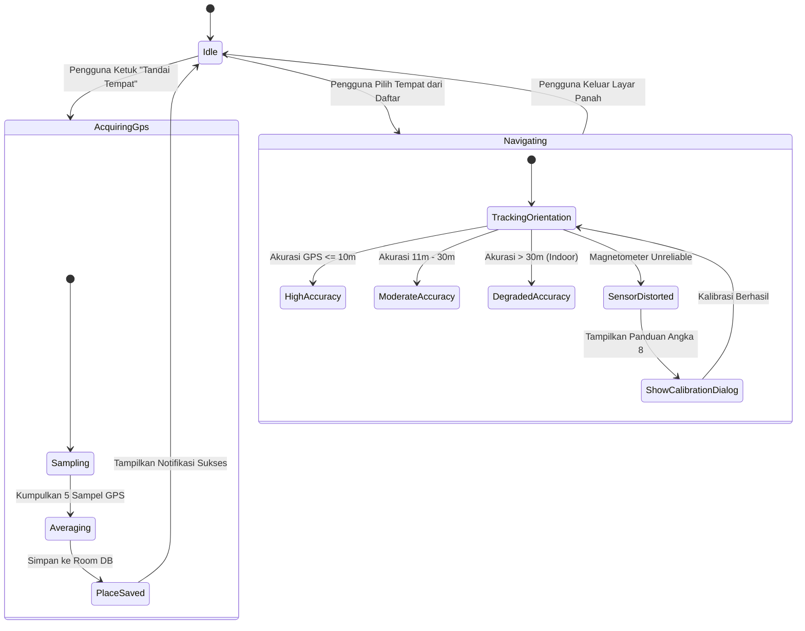

---

### 17.4 Pelacakan Keluarga Berbasis Persetujuan Eksplisit (Consent-First Tracking)

#### 17.4.1 Protokol Pertukaran Token QR Sekali Pakai (One-Time Token Protocol)
Untuk menjamin tidak ada pelacakan rahasia (*stalking*) dan mencegah pembacaan QR oleh pihak asing:
1. **Entropi Tinggi:** Token QR terdiri dari string acak UUID v4 (128-bit) yang digabungkan dengan nonce kriptografis 64-bit yang dihasilkan oleh `SecureRandom`.
2. **Masa Berlaku Ketat:** Token memiliki atribut `expires_at` tepat 300 detik (5 menit) sejak diterbitkan di server.
3. **Klaim Atomik Sekali Pakai (Single-Use Atomic Claim):** Validasi penukaran token di backend dieksekusi di dalam transaksi database atomik (*Firestore Transaction*) untuk mencegah *race condition* dan *double-claim*.

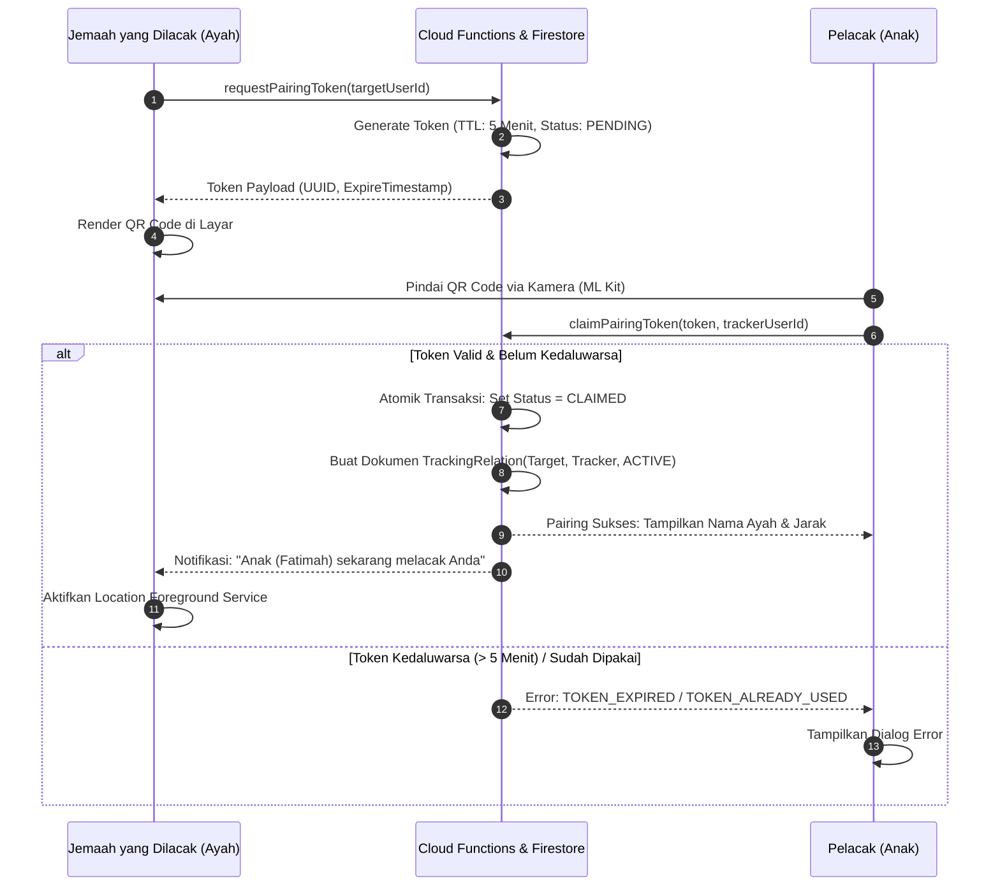

#### 17.4.2 Kontrol Pencabutan Izin & Penghentian Instan
Pihak yang dilacak memiliki kendali mutlak:
- Layar "Siapa yang Melacak Saya" menampilkan daftar seluruh pelacak aktif.
- Menekan tombol "Cabut Izin" seketika mengubah status `TrackingRelation` menjadi `REVOKED`.
- Aturan keamanan backend (*Firestore Rules*) langsung menolak seluruh permintaan pembacaan lokasi dari pelacak yang telah dicabut izinnya.

---

### 17.5 Layanan Lokasi Latar Belakang (Android Foreground Service)

#### 17.5.1 Kepatuhan Android 14+ (API Level 34+)
Sesuai regulasi Android 14+, layanan lokasi latar belakang dideklarasikan secara eksplisit dengan tipe lokasi:
- Deklarasi Manifest:
  ```xml
  <service
      android:name=".tracking.LocationTrackingService"
      android:foregroundServiceType="location"
      android:exported="false" />
  ```
- Permintaan Izin Runtime Bertahap:
  1. Tahap 1: `android.permission.ACCESS_COARSE_LOCATION` & `ACCESS_FINE_LOCATION`.
  2. Tahap 2: `android.permission.POST_NOTIFICATIONS` (untuk notifikasi persisten).
  3. Layanan dimulai secara eksklusif hanya saat aplikasi sedang berada di *foreground* (`context.startForegroundService()`).

#### 17.5.2 Notifikasi Persisten yang Tidak Dapat Dihapus
Layanan terikat dengan notifikasi status bar permanen:
- Channel ID: `channel_hajj_tracking` (Importance: `IMPORTANCE_LOW` agar tidak bersuara setiap pembaruan lokasi).
- Properti Notifikasi: `setOngoing(true)`, icon aktif, dan aksi langsung "Buka Aplikasi" serta "Hentikan Berbagi Lokasi".

#### 17.5.3 Algoritma Penghematan Baterai Adaptif
Interval pengambilan sampel Fused Location Provider menyesuaikan status mobilitas jemaah:
- **Kondisi Bergerak (Moving Window):** Jika kecepatan perangkat $> 0.5\text{ m/s}$, interval pembaruan disetel $30\text{ detik}$, jarak pergeseran minimal $10\text{ meter}$.
- **Kondisi Diam (Stationary Window):** Jika perangkat berada dalam radius yang sama selama $> 3\text{ menit}$ (misalnya saat istirahat di dalam tenda Mina), interval diperpanjang otomatis menjadi $5\text{ menit}$.

---

### 17.6 Sinkronisasi Telemetri & Antrean Offline Store-and-Forward

1. **Minimisasi Data:** Server backend hanya menyimpan 1 dokumen koordinat mutakhir per jemaah (`last_known_location`), bukan riwayat perjalanan.
2. **Antrean Lokal FIFO:** Jika jaringan internet terputus saat berada di lembah Muzdalifah atau Mina, titik lokasi disimpan di tabel Room `location_sync_queue` dengan kapasitas maksimal 50 sampel.
3. **Pembersihan Otomatis:** Saat koneksi pulih, sistem hanya mengirimkan 1 titik sampel paling mutakhir dan menghapus seluruh antrean lama yang telah basi (*stale coordinates*), guna menghemat kuota roaming jemaah dan bandwidth server.

---

### 17.7 Autentikasi dan Manajemen Identitas

Sistem menerapkan **Firebase Anonymous Authentication** yang dikombinasikan dengan pengikatan QR fisik:
- **Tanpa Pendaftaran Rumit:** Jemaah lansia tidak perlu memasukkan email atau kata sandi; aplikasi menghasilkan identitas anonim unik (`uid`) saat pertama kali dibuka.
- **Pengikatan Akun:** Hubungan kekeluargaan dibangun murni melalui pemindaian QR code fisik antar-perangkat.
- **Pembersihan Identitas:** Saat tombol "Hapus Akun & Data" ditekan, sesi anonim ditutup dan seluruh data relasi serta koordinat terkait di Firestore dihapus permanen.

---

## 18. DATA MODEL DAN DATA DICTIONARY

### 18.1 Kamus Data Entitas Sistem (Complete Data Dictionary)

```
+-------------------------------------------------------------------------------------------------------------------------------------------------------+
|                                                          SYSTEM DATA DICTIONARY                                                                       |
+--------------------------+-----------------------+----------+-------------------------------------+-----------------+---------------+-----------------+
| Entitas / Kolom          | Tipe Data             | Nullable | Format & Batasan Nilai              | Relasi / Kunci  | Retensi Data  | Klasifikasi     |
+--------------------------+-----------------------+----------+-------------------------------------+-----------------+---------------+-----------------+
| Day.day_id               | String (VARCHAR 32)   | No       | Format: "day_XX_zulhijah"           | PK              | Permanen      | Publik / Konten |
| Day.hijri_day            | Integer (TINYINT)     | No       | Rentang: 1 s.d. 30                  | -               | Permanen      | Publik / Konten |
| Day.title                | String (VARCHAR 128)  | No       | Teks judul hari manasik             | -               | Permanen      | Publik / Konten |
| Activity.activity_id     | String (VARCHAR 64)   | No       | Format: "act_XXX"                   | PK              | Permanen      | Publik / Konten |
| Activity.day_id          | String (VARCHAR 32)   | No       | Foreign Key merujuk Day             | FK              | Permanen      | Publik / Konten |
| Activity.ruling_category | Enum String           | No       | "RUKUN", "WAJIB", "SUNAH"           | -               | Permanen      | Publik / Konten |
| Step.step_id             | String (VARCHAR 64)   | No       | Format: "step_XXX"                  | PK              | Permanen      | Publik / Konten |
| Reading.reading_id       | String (VARCHAR 64)   | No       | Format: "read_XXX"                  | PK              | Permanen      | Publik / Konten |
| Reading.arabic_text      | Text                  | No       | Unicode UTF-8 Uthmani               | -               | Permanen      | Publik / Konten |
| Reading.latin_text       | Text                  | No       | Transliterasi Latin                 | -               | Permanen      | Publik / Konten |
| Reading.translation_id   | Text                  | No       | Bahasa Indonesia                    | -               | Permanen      | Publik / Konten |
| SavedPlace.place_id      | String (UUID v4)      | No       | 36 karakter UUID                    | PK (Room)       | Lokal Pribadi | Sensitif Lokasi |
| SavedPlace.name          | String (VARCHAR 64)   | No       | Nama tempat (misal: "Pintu 15")     | -               | Lokal Pribadi | Pribadi         |
| SavedPlace.category      | Enum String           | No       | "DOOR","HOTEL","CAMP","BUS","OTHER" | -               | Lokal Pribadi | Pribadi         |
| SavedPlace.latitude      | Double (FLOAT8)       | No       | Rentang: -90.0 s.d. +90.0           | -               | Lokal Pribadi | Sensitif Spasial|
| SavedPlace.longitude     | Double (FLOAT8)       | No       | Rentang: -180.0 s.d. +180.0         | -               | Lokal Pribadi | Sensitif Spasial|
| SavedPlace.accuracy_m    | Float                 | No       | Estimasi galat meter (>= 0.0)       | -               | Lokal Pribadi | Operasional     |
| SavedPlace.created_at    | Long (Timestamp MS)   | No       | Epoch milliseconds                  | -               | Lokal Pribadi | Operasional     |
| Checklist.step_id        | String (VARCHAR 64)   | No       | Merujuk Step.step_id                | PK (Room)       | Lokal Pribadi | Pribadi         |
| Checklist.is_completed   | Boolean (TINYINT 1)   | No       | 1 = Selesai, 0 = Belum              | -               | Lokal Pribadi | Pribadi         |
| Checklist.completed_at   | Long (Timestamp MS)   | Yes      | Epoch ms saat dicentang             | -               | Lokal Pribadi | Pribadi         |
| PairingToken.token_id    | String (VARCHAR 64)   | No       | 256-bit crypto token string         | PK (Firestore)  | 5 Menit (TTL)  | Rahasia Kunci   |
| PairingToken.target_uid  | String (VARCHAR 128)  | No       | Firebase UID pemilik QR              | FK               | 5 Menit (TTL)  | Identitas Akun  |
| PairingToken.status      | Enum String           | No       | "PENDING", "CLAIMED", "EXPIRED"     | -               | 5 Menit (TTL)  | Status Sesi     |
| TrackingRelation.id      | String (VARCHAR 128)  | No       | "rel_{trackerUid}_{targetUid}"       | PK (Firestore)  | Akhir Haji / 40h| Rahasia Relasi  |
| TrackingRelation.status  | Enum String           | No       | "ACTIVE", "REVOKED", "PAUSED"        | -               | Akhir Haji / 40h| Status Akses    |
| UserLocation.user_id     | String (VARCHAR 128)  | No       | Firebase UID pemilik lokasi          | PK (Firestore)  | 24 Jam (TTL)   | PII Sangat Rahas|
| UserLocation.latitude    | Double (FLOAT8)       | No       | Koordinat Lintang Terkini            | -               | 24 Jam (TTL)   | PII Sangat Rahas|
| UserLocation.longitude   | Double (FLOAT8)       | No       | Koordinat Bujur Terkini              | -               | 24 Jam (TTL)   | PII Sangat Rahas|
| UserLocation.accuracy_m  | Float                 | No       | Radius Akurasi (Meter)               | -               | 24 Jam (TTL)   | PII Spasial     |
| UserLocation.updated_at  | Long (Timestamp MS)   | No       | Waktu pembaruan lokasi               | Indeks Firestore | 24 Jam (TTL)   | Operasional     |
+--------------------------+-----------------------+----------+-------------------------------------+-----------------+---------------+-----------------+
```

---

## 19. LOCAL DATABASE DAN CONTENT SCHEMA

### 19.1 Skema Room Database Klien (DDL SQL & Entity Kotlin)

Aplikasi menggunakan Room (SQLite) untuk menyimpan tempat tersimpan, status checklist, antrean offline telemetri, dan preferensi pengguna:

```sql
-- 1. Tabel Tempat Tersimpan (Places Table)
CREATE TABLE IF NOT EXISTS `saved_places` (
    `place_id` TEXT NOT NULL PRIMARY KEY,
    `name` TEXT NOT NULL,
    `category` TEXT NOT NULL,
    `latitude` REAL NOT NULL,
    `longitude` REAL NOT NULL,
    `accuracy_meters` REAL NOT NULL,
    `notes` TEXT,
    `photo_uri` TEXT,
    `created_at_epoch_ms` INTEGER NOT NULL
);
CREATE INDEX IF NOT EXISTS `idx_saved_places_category` ON `saved_places` (`category`);

-- 2. Tabel Checklist Progres Manasik
CREATE TABLE IF NOT EXISTS `checklist_progress` (
    `step_id` TEXT NOT NULL PRIMARY KEY,
    `is_completed` INTEGER NOT NULL DEFAULT 0,
    `completed_at_epoch_ms` INTEGER
);

-- 3. Tabel Antrean Pengiriman Lokasi (Offline Sync Queue)
CREATE TABLE IF NOT EXISTS `location_sync_queue` (
    `queue_id` INTEGER PRIMARY KEY AUTOINCREMENT NOT NULL,
    `latitude` REAL NOT NULL,
    `longitude` REAL NOT NULL,
    `accuracy_meters` REAL NOT NULL,
    `timestamp_epoch_ms` INTEGER NOT NULL,
    `retry_count` INTEGER NOT NULL DEFAULT 0
);
CREATE INDEX IF NOT EXISTS `idx_queue_timestamp` ON `location_sync_queue` (`timestamp_epoch_ms`);

-- 4. Tabel Virtual Pencarian Cepat Manasik (FTS4)
CREATE VIRTUAL TABLE IF NOT EXISTS `guide_search_fts` USING fts4(
    `content_id`,
    `title`,
    `body_text`,
    `arabic_text`,
    tokenize=unicode61
);
```

#### Entity Kotlin & Data Access Object (DAO)
```kotlin
@Entity(tableName = "saved_places")
data class SavedPlaceEntity(
    @PrimaryKey val place_id: String = UUID.randomUUID().toString(),
    val name: String,
    val category: String, // DOOR, HOTEL, CAMP, BUS, OTHER
    val latitude: Double,
    val longitude: Double,
    val accuracy_meters: Float,
    val notes: String?,
    val photo_uri: String?,
    val created_at_epoch_ms: Long = System.currentTimeMillis()
)

@Dao
interface PlacesDao {
    @Query("SELECT * FROM saved_places ORDER BY created_at_epoch_ms DESC")
    fun getAllPlacesFlow(): Flow<List<SavedPlaceEntity>>

    @Insert(onConflict = OnConflictStrategy.REPLACE)
    suspend fun insertPlace(place: SavedPlaceEntity)

    @Delete
    suspend fun deletePlace(place: SavedPlaceEntity)
}
```

---

## 20. BACKEND ARCHITECTURE (FIREBASE PLATFORM)

### 20.1 Skema Koleksi Cloud Firestore
Data diorganisasikan ke dalam dokumen yang terpisah secara tegas antara akun, relasi konsensus, dan lokasi:

```
/users/{userId}
    - created_at: Timestamp
    - display_name: String (Inisial/Label)
    - platform: "ANDROID"

/pairing_tokens/{tokenId}
    - target_uid: String
    - expires_at: Timestamp (TTL: 5 menit)
    - status: "PENDING" | "CLAIMED" | "EXPIRED"

/tracking_relations/{relationId}  // Document ID: targetUid_trackerUid
    - target_uid: String
    - tracker_uid: String
    - status: "ACTIVE" | "REVOKED"
    - paired_at: Timestamp
    - expires_at: Timestamp (Akhir Musim Haji 2027)

/locations/{userId}
    - latitude: Double
    - longitude: Double
    - accuracy: Float
    - updated_at: Timestamp (TTL: 24 jam)
```

### 20.2 Aturan Keamanan Firestore (Firestore Security Rules)
Aturan keamanan diterapkan di tingkat kernel database untuk menegakkan kepatuhan persetujuan privasi secara mutlak:

```javascript
rules_version = '2';
service cloud.firestore {
  match /databases/{database}/documents {
    
    // Fungsi pembantu otentikasi
    function isAuthenticated() {
      return request.auth != null;
    }
    
    function isOwner(userId) {
      return isAuthenticated() && request.auth.uid == userId;
    }
    
    // Memeriksa apakah pemanggil memiliki relasi pelacakan aktif terhadap target
    function hasActiveTrackingConsent(targetUserId) {
      let relId = targetUserId + "_" + request.auth.uid;
      return isAuthenticated() && 
        exists(/databases/$(database)/documents/tracking_relations/$(relId)) &&
        get(/databases/$(database)/documents/tracking_relations/$(relId)).data.status == "ACTIVE";
    }

    // 1. Dokumen User
    match /users/{userId} {
      allow read, write: if isOwner(userId);
    }

    // 2. Token Pairing QR: Hanya dibuat oleh pemilik, diklaim via Cloud Functions
    match /pairing_tokens/{tokenId} {
      allow read: if isAuthenticated();
      allow create: if isAuthenticated() && request.resource.data.target_uid == request.auth.uid;
      allow update, delete: if false; // Mutasi hanya melalui Cloud Functions terpercaya
    }

    // 3. Relasi Tracking: Hanya dapat dibaca oleh kedua belah pihak yang bersangkutan
    match /tracking_relations/{relationId} {
      allow read: if isAuthenticated() && 
        (resource.data.target_uid == request.auth.uid || resource.data.tracker_uid == request.auth.uid);
      allow update: if isAuthenticated() && resource.data.target_uid == request.auth.uid; // Target berhak mencabut izin
      allow create, delete: if false; // Dikelola oleh Cloud Functions
    }

    // 4. Data Lokasi: Hanya pemilik yang dapat menulis, hanya tracker sah yang dapat membaca
    match /locations/{userId} {
      allow write: if isOwner(userId);
      allow read: if isOwner(userId) || hasActiveTrackingConsent(userId);
    }
  }
}
```

---

## 21. API DAN INTEGRATION CONTRACTS

Seluruh interaksi backend yang sensitif (pembuatan token, klaim token, pencabutan izin, dan pembersihan akun) dienkapsulasi melalui Cloud Functions (REST/HTTPS Callable Endpoints) yang terdokumentasi lengkap:

### 21.1 Katalog Endpoint API

#### 1. Endpoint: POST /api/generatePairingToken
- **Tujuan:** Menghasilkan token QR acak bertempo 5 menit bagi jemaah yang bersedia dilacak.
- **Autentikasi:** Wajib Firebase Auth Bearer Token.
- **Request Headers:** `Authorization: Bearer <ID_TOKEN>`, `Content-Type: application/json`.
- **Request Body:**
  ```json
  {
    "client_timestamp_ms": 1779600000000
  }
  ```
- **Response Success (HTTP 201 Created):**
  ```json
  {
    "status": "SUCCESS",
    "token_id": "tok_9f8c2e1b4a7d",
    "qr_payload": "hajj2027://pair?t=tok_9f8c2e1b4a7d&u=usr_ayah_123",
    "expires_at_epoch_ms": 1779600300000,
    "validity_seconds": 300
  }
  ```
- **Response Error (HTTP 429 Too Many Requests):**
  ```json
  {
    "error_code": "RATE_LIMITED",
    "message": "Terlalu banyak permintaan token. Tunggu 60 detik sebelum membuat kode baru."
  }
  ```

#### 2. Endpoint: POST /api/claimPairingToken
- **Tujuan:** Pelacak mengklaim token setelah memindai QR untuk mengaktifkan hubungan pelacakan.
- **Autentikasi:** Wajib Firebase Auth Bearer Token.
- **Request Body:**
  ```json
  {
    "token_id": "tok_9f8c2e1b4a7d",
    "tracker_label": "Fatimah (Anak)"
  }
  ```
- **Response Success (HTTP 200 OK):**
  ```json
  {
    "status": "SUCCESS",
    "relation_id": "rel_usr_ayah_123_usr_fatimah_456",
    "target_user_id": "usr_ayah_123",
    "paired_at_epoch_ms": 1779600050000,
    "message": "Penyambungan keluarga berhasil. Lokasi mulai dipantau."
  }
  ```
- **Response Error (HTTP 410 Gone / 400 Bad Request):**
  ```json
  {
    "error_code": "TOKEN_EXPIRED",
    "message": "Kode QR telah kedaluwarsa. Silakan minta kerabat menampilkan kode QR baru."
  }
  ```

#### 3. Endpoint: POST /api/revokeTrackingAccess
- **Tujuan:** Orang yang dilacak mencabut hak akses salah satu atau seluruh pelacak secara instan.
- **Request Body:**
  ```json
  {
    "tracker_user_id": "usr_fatimah_456"
  }
  ```
- **Response Success (HTTP 200 OK):**
  ```json
  {
    "status": "SUCCESS",
    "revoked_tracker_user_id": "usr_fatimah_456",
    "timestamp_ms": 1779600100000
  }
  ```

#### 4. Endpoint: POST /api/purgeUserData
- **Tujuan:** Menghapus identitas anonim, seluruh riwayat koordinat, dan relasi tracking (Right to be Forgotten).
- **Response Success (HTTP 200 OK):**
  ```json
  {
    "status": "SUCCESS",
    "purged_user_id": "usr_ayah_123",
    "message": "Seluruh data Anda telah dihapus secara permanen dari server."
  }
  ```

### 21.2 Katalog Kode Error Standar (Standard Error Contract)
| Kode Error | HTTP Status | Penjelasan & Tindakan Antarmuka (UI Action) |
| :--- | :---: | :--- |
| `AUTH_REQUIRED` | 401 | Sesi autentikasi habis; lakukan inisialisasi ulang anonim transparan di latar belakang. |
| `TOKEN_EXPIRED` | 410 | Masa berlaku QR (5 menit) habis; tampilkan pesan ramah lansia: "Kode QR kedaluwarsa, buat kode baru". |
| `TOKEN_ALREADY_USED`| 409 | Token telah diklaim pihak lain; cegah serangan replay, minta QR baru. |
| `TRACKING_ACCESS_REVOKED`| 403 | Izin telah dicabut oleh pihak target; tampilkan banner: "Akses lokasi kerabat telah dinonaktifkan". |
| `LOCATION_PERMISSION_DENIED`| - | Klien: Izin GPS ditolak sistem; tampilkan panduan membuka pengaturan aplikasi. |
| `LOCATION_STALE` | - | Klien: Posisi target > 30 menit; beri penanda visual abu-abu dan label: "Sinyal Terakhir X Menit Lalu". |
| `CONTENT_INTEGRITY_FAILED`| - | Klien: Hash SHA-256 payload JSON tidak cocok; batalkan pembaruan dan pertahankan data bawaan. |
| `NETWORK_UNAVAILABLE`| 503 | Koneksi internet mati; simpan mutasi telemetri ke antrean SQLite offline lokal. |
| `RATE_LIMITED` | 429 | Panggilan API melebihi ambang batas wajar (anti-spam); terapkan exponential backoff. |

## 22. UI/UX DESIGN SYSTEM

Sistem antarmuka dirancang mengikuti filosofi **"Accessible & Ethical Design"** yang dioptimalkan secara khusus untuk jemaah lanjut usia (usia 60+ tahun) serta kondisi fisik ekstrem di Tanah Suci (terik sinar matahari padang pasir, kerumunan padat, kelelahan fisik, dan getaran saat berjalan).

### 22.1 Token Desain Jetpack Compose (Design Tokens)

```kotlin
object HajjDesignTokens {
    // 1. Color Palette (WCAG AAA Compliance: Kontras >= 7:1)
    val PrimaryDarkNavy     = Color(0xFF0C4A6E) // Teks utama & Header kontras tinggi
    val PrimaryTrustBlue    = Color(0xFF0369A1) // Brand & Container primer
    val AccentHajjGreen     = Color(0xFF15803D) // Tombol Aksi Utama / Sukses (Emerald)
    val BackgroundSoftSky   = Color(0xFFF8FAFC) // Latar belakang anti-glare
    val SurfaceWhite        = Color(0xFFFFFFFF) // Permukaan kartu
    val MutedTextSlate      = Color(0xFF334155) // Teks sekunder (Kontras 5.2:1)
    val BorderSubtle        = Color(0xFFCBD5E1) // Pembatas garis tegas
    val StatusAmberWarning  = Color(0xFFB45309) // Peringatan sensor / akurasi sedang
    val StatusRedError      = Color(0xFFB91C1C) // Error / GPS indoor degradation
    val FocusRingCyan       = Color(0xFF0284C7) // Indikator fokus 4dp

    // 2. Dimensi Sentuh Ramah Lansia (Elderly Touch Target Standards)
    val MinTouchTargetSize  = 56.dp // Standar tombol (jauh melampaui 48dp Android)
    val TouchTargetGap      = 12.dp // Jarak antar tombol untuk cegah salah sentuh
    val CardCornerRadius    = 16.dp // Radius sudut lembut & modern
    val FocusBorderWidth    = 3.dp  // Ketebalan garis fokus

    // 3. Skala Spasi Irama 8dp (Spacing Grid)
    val SpaceExtraSmall     = 4.dp
    val SpaceSmall          = 8.dp
    val SpaceMedium         = 16.dp
    val SpaceLarge          = 24.dp
    val SpaceExtraLarge     = 32.dp

    // 4. Tipografi Khusus Keterbacaan Tinggi
    val TypographyArabicTitle = TextStyle(
        fontFamily = FontFamily(Font(R.font.amiri_bold)),
        fontSize = 28.sp,
        lineHeight = 44.sp,
        fontWeight = FontWeight.Bold
    )
    val TypographyArabicBody  = TextStyle(
        fontFamily = FontFamily(Font(R.font.amiri_regular)),
        fontSize = 24.sp,
        lineHeight = 40.sp,
        textDirection = TextDirection.Rtl
    )
    val TypographyElderlyTitle = TextStyle(
        fontFamily = FontFamily(Font(R.font.atkinson_hyperlegible_bold)),
        fontSize = 22.sp,
        lineHeight = 30.sp,
        fontWeight = FontWeight.Bold
    )
    val TypographyElderlyBody = TextStyle(
        fontFamily = FontFamily(Font(R.font.atkinson_hyperlegible_regular)),
        fontSize = 18.sp,
        lineHeight = 26.sp,
        fontWeight = FontWeight.Normal
    )
    val TypographyButton      = TextStyle(
        fontFamily = FontFamily(Font(R.font.atkinson_hyperlegible_bold)),
        fontSize = 20.sp,
        lineHeight = 28.sp,
        fontWeight = FontWeight.Bold
    )
}
```

### 22.2 Prinsip Ergonomi & Anti-Patterns (UI Pro Max Rules)
1. **Dilarang Menggunakan Emoji sebagai Ikon Struktural:** Seluruh ikon wajib menggunakan aset vektor SVG monokrom (Material Icons / Phosphor Vector Drawables) dengan ukuran minimal `32x32 dp`.
2. **Tanpa Gradient AI Ungu/Merah Muda:** Warna antarmuka mengacu pada warna tanah suci dan keandalan korporat: *Deep Navy Blue* (Ketenangan), *Pure White* (Kain Ihram), dan *Emerald Green* (Ketaatan & Kepastian).
3. **Pencegahan Salah Ketuk (Accidental Mis-tap Prevention):** Tindakan berisiko tinggi (misal: "Cabut Izin Melacak", "Hapus Tempat", "Reset Akun") wajib menggunakan dialog konfirmasi 2-langkah dengan tombol aksi berwarna merah berjarak minimal 16dp dari tombol batal.
4. **Independensi Orientasi:** Seluruh UI dikunci secara tegas dalam mode Portrait (`screenOrientation="portrait"`) untuk menjamin konsistensi navigasi kompas dan mempermudah pengoperasian dengan satu tangan.

---

## 23. INFORMATION ARCHITECTURE DAN NAVIGATION

### 23.1 Sitemap & Pohon Navigasi Aplikasi

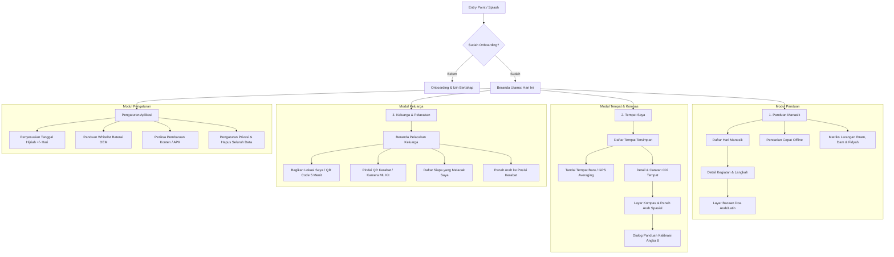

### 23.2 Perilaku Tombol Kembali (Back Navigation Contract)
- Menekan tombol *Back* fisik/gesture Android pada layar detail selalu mengembalikan jemaah ke layar Beranda Utama ("Hari Ini").
- Menekan tombol *Back* pada Beranda Utama tidak langsung menutup aplikasi, melainkan memunculkan snackbar konfirmasi: *"Tekan sekali lagi untuk keluar"*, mencegah aplikasi tertutup tidak sengaja saat jemaah memegang ponsel dengan tangan gemetar.

---

## 24. SCREEN SPECIFICATIONS & PROTOTIPE TEKSTUAL (ASCII WIREFRAMES)

### 24.1 Layar SCR-01: Beranda Utama ("Hari Ini")
- **Tujuan:** Gerbang utama aplikasi yang menyajikan konteks waktu ibadah instan dan 3 aksi sentuh besar.
- **Pengguna:** Seluruh jemaah (fokus lansia).
- **Komponen Utama:**
  1. Header Status: Tanggal Hijriah terkompensasi, tanggal Masehi, dan indikator status offline (Ikon "Offline Siap").
  2. Kartu Rangkuman Hari Ini: Judul hari, lokasi (Arafah/Mina/Makkah), dan bilah progres manasik.
  3. Tiga Tombol Aksi Raksasa: [PANDUAN MANASIK], [TEMPAT SAYA], [LACAK KELUARGA].

```
+-------------------------------------------------------------+
| [=] PANDUAN HAJI 2027              [Offline: Siap] [⚙]      |
+-------------------------------------------------------------+
| HARI INI DI TANAH SUCI:                                     |
| 9 Zulhijah 1448 H / Kamis, 20 Mei 2027                      |
+-------------------------------------------------------------+
| +---------------------------------------------------------+ |
| |  WUKUF DI ARAFAH (Puncak Haji)                          | |
| |  Lokasi: Padang Arafah                                  | |
| |  Progres Ibadah Hari Ini: 2 dari 5 Langkah Selesai      | |
| |  [=====================>..................] 40%         | |
| +---------------------------------------------------------+ |
+-------------------------------------------------------------+
|                                                             |
| +---------------------------------------------------------+ |
| |                                                         | |
| |   [📖]  1. PANDUAN HARI INI                             | |
| |         Buka rangkaian ibadah & doa hari ini            | |
| |                                                         | |
| +---------------------------------------------------------+ |
|                                                             |
| +---------------------------------------------------------+ |
| |                                                         | |
| |   [📍]  2. TEMPAT SAYA                                  | |
| |         Arah kembali ke Hotel, Pintu, & Tenda           | |
| |                                                         | |
| +---------------------------------------------------------+ |
|                                                             |
| +---------------------------------------------------------+ |
| |                                                         | |
| |   [👥]  3. LACAK KELUARGA                               | |
| |         Pantau posisi kerabat & bagikan lokasi          | |
| |                                                         | |
| +---------------------------------------------------------+ |
|                                                             |
+-------------------------------------------------------------+
| [!] Butuh bantuan darurat? Hubungi Ketua Rombongan: 05xxxx  |
+-------------------------------------------------------------+
```

---

### 24.2 Layar SCR-02: Detail Kegiatan Manasik & Checklist
- **Tujuan:** Menyajikan rincian teknis pelaksanaan ibadah langkah demi langkah beserta kotak centang penyelesaian.

```
+-------------------------------------------------------------+
| [< KEMBALI]         WUKUF DI ARAFAH                         |
+-------------------------------------------------------------+
| Status Hukum: RUKUN HAJI (Wajib Dikerjakan Sendiri)         |
| Waktu: Setelah Dzuhur s.d. Terbenam Matahari                |
+-------------------------------------------------------------+
| CATATAN PENTING:                                            |
| Pastikan berada di dalam batas Arafah. Menghadap kiblat     |
| dan perbanyak doa. Boleh di dalam tenda atau di luar.       |
+-------------------------------------------------------------+
| LANGKAH-LANGKAH MANASIK:                                    |
|                                                             |
| [X] 1. Mendengarkan Khutbah Arafah di tenda / masjid        |
|      (Selesai pukul 12:45)                                  |
|                                                             |
| [X] 2. Salat Jamak Qasar Dzuhur & Ashar                     |
|      (2 rakaat Dzuhur + 2 rakaat Ashar, 1 adzan 2 iqamah)   |
|                                                             |
| [ ] 3. Masuk Waktu Wukuf & Berdoa Khusyuk                   |
|      [ LIHAT BACAAN DOA ARAFAH (ARAB/LATIN) >> ]            |
|      [ ] Tandai Langkah Ini Selesai                         |
|                                                             |
| [ ] 4. Membaca Zikir Sore Hari Arafah                       |
|      [ ] Tandai Langkah Ini Selesai                         |
|                                                             |
| [ ] 5. Bersiap Berangkat ke Muzdalifah (Setelah Maghrib)    |
|      [ ] Tandai Langkah Ini Selesai                         |
+-------------------------------------------------------------+
| [!] Catatan Ikhtilaf: Ada perbedaan waktu keberangkatan     |
|     rombongan ke Muzdalifah. Ikuti instruksi ketua kloter.  |
+-------------------------------------------------------------+
```

---

### 24.3 Layar SCR-03: Bacaan Doa Multilingual (Arab, Latin, Terjemahan)
- **Tujuan:** Memudahkan lansia membaca doa dalam aksara Arab besar, transliterasi Latin yang jelas, dan maknanya.

```
+-------------------------------------------------------------+
| [< KEMBALI]        DOA & ZIKIR HARI ARAFAH                  |
+-------------------------------------------------------------+
| Zikir Terbaik di Hari Arafah (HR. Tirmidzi):                |
|                                                             |
|   لَا إِلَهَ إِلَّا اللَّهُ وَحْدَهُ لَا شَرِيكَ لَهُ،     |
|   لَهُ الْمُلْكُ وَلَهُ الْحَمْدُ،                          |
|   وَهُوَ عَلَى كُلِّ شَيْءٍ قَدِيرٌ                        |
|                                                             |
| Cara Membaca (Latin):                                       |
| "Laa ilaaha illallaahu wahdahu laa syariika lah,            |
|  lahul mulku wa lahul hamdu,                                |
|  wa huwa 'alaa kulli syai-in qadiir."                       |
|                                                             |
| Artinya:                                                    |
| "Tidak ada sesembahan yang berhak disembah selain Allah     |
|  semata, tidak ada sekutu bagi-Nya. Milik-Nya segala        |
|  kerajaan dan bagi-Nya segala pujian, dan Dia Mahakuasa     |
|  atas segala sesuatu."                                      |
+-------------------------------------------------------------+
| Anjuran:                                                    |
| Ulangi zikir ini sebanyak-banyaknya sambil mengangkat       |
| kedua tangan dan menghadap ke arah Kiblat.                  |
+-------------------------------------------------------------+
| [ UKURAN TEKS: (A-) NORMAL | (A+) BESAR LANSIA ]            |
+-------------------------------------------------------------+
```

---

### 24.4 Layar SCR-04: Kompas Navigasi Panah Spasial ("Tempat Saya")
- **Tujuan:** Memandu jemaah kembali ke pintu masuk, hotel, atau tenda menggunakan panah putar garis lurus.

```
+-------------------------------------------------------------+
| [< KEMBALI]        MENUJU: PINTU 1 (KING ABDULAZIZ)         |
+-------------------------------------------------------------+
| Status Sensor: [ HIJAU: AKURASI GPS BAIK (8 Meter) ]        |
+-------------------------------------------------------------+
|                                                             |
|                            / \                              |
|                           / ^ \                             |
|                          / / \ \                            |
|                         / /   \ \                           |
|                        /_/  |  \_\                          |
|                             |                               |
|                             |                               |
|                             |                               |
|                                                             |
|                      JARAK LANGSUNG:                        |
|                     340 METER LAGI                          |
|                                                             |
+-------------------------------------------------------------+
| [!] PERINGATAN PENTING:                                     |
| Panah menunjukkan GARIS LURUS, bukan jalur jalan kaki.      |
| Perhatikan tembok, tangga, pembatas jalan, dan kerumunan.   |
+-------------------------------------------------------------+
| Catatan Tempat: Dekat Menara Jam, ada plang nomor hijau     |
| [ KALIBRASI KOMPAS ]                     [ HAPUS TEMPAT ]   |
+-------------------------------------------------------------+
```

---

### 24.5 Layar SCR-05: Bagikan Lokasi Saya (Tampilan QR Code 5 Menit)
- **Tujuan:** Menampilkan QR code otorisasi agar pasangan/anak dapat memindai dan memantau posisi jemaah.

```
+-------------------------------------------------------------+
| [< BATAL]          BAGIKAN LOKASI SAYA                      |
+-------------------------------------------------------------+
| Mintalah keluarga (suami/istri/anak) untuk MEMINDAI         |
| kode QR di bawah ini menggunakan aplikasi mereka:           |
|                                                             |
|              +-----------------------------+                |
|              |  ######  ##  ##  ##  ###### |                |
|              |  ##  ##  ######  ##  ##  ## |                |
|              |  ######  ##  ######  ###### |                |
|              |  ######  ######  ##  ###### |                |
|              |  ##  ##  ##  ##  ##  ##  ## |                |
|              |  ######  ######  ##  ###### |                |
|              +-----------------------------+                |
|                                                             |
|               KODE KEDALUWARSA DALAM:                       |
|                      04 : 32                                |
|                                                             |
+-------------------------------------------------------------+
| KETENTUAN PRIVASI:                                          |
| • Kode ini hanya dapat digunakan SATU KALI.                 |
| • Hanya orang yang memindai kode ini yang dapat melihat     |
|   lokasi Anda.                                              |
| • Anda dapat mencabut izin pelacakan kapan saja.            |
+-------------------------------------------------------------+
| [ BUAT KODE BARU ]                  [ SELESAI / TUTUP ]     |
+-------------------------------------------------------------+
```

---

### 24.6 Layar SCR-06: Manajemen Izin ("Siapa yang Melacak Saya")
- **Tujuan:** Memberikan transparansi mutlak kepada jemaah atas siapa saja yang saat ini memiliki akses koordinatnya.

```
+-------------------------------------------------------------+
| [< KEMBALI]       SIAPA YANG MELACAK SAYA                   |
+-------------------------------------------------------------+
| Status Berbagi Lokasi: [ AKTIF - SEDANG BERJALAN ]          |
| Layanan lokasi berjalan di latar belakang (Foreground).    |
+-------------------------------------------------------------+
| DAFTAR ANGGOTA KELUARGA TERDAFTAR:                          |
|                                                             |
| 1. Fatimah (Anak Perempuan)                                 |
|    Terhubung sejak: 18 Mei 2027                             |
|    Status: Aktif Memantau                                   |
|    [ CABUT IZIN ]                                           |
|                                                             |
| 2. H. Ahmad Dahlan (Suami)                                  |
|    Terhubung sejak: 19 Mei 2027                             |
|    Status: Aktif Memantau                                   |
|    [ CABUT IZIN ]                                           |
+-------------------------------------------------------------+
|                                                             |
| [ STOP SEMUA PELACAKAN (HENTIKAN LAYANAN LOKASI) ]          |
|                                                             |
+-------------------------------------------------------------+
| [!] Menekan tombol stop akan seketika mematikan pengiriman   |
|     posisi Anda ke seluruh keluarga terdaftar.              |
+-------------------------------------------------------------+
```

---

## 25. INTERACTION FLOWS

### 25.1 Alur Penggunaan Lengkap Jemaah Lansia (End-to-End User Flow)

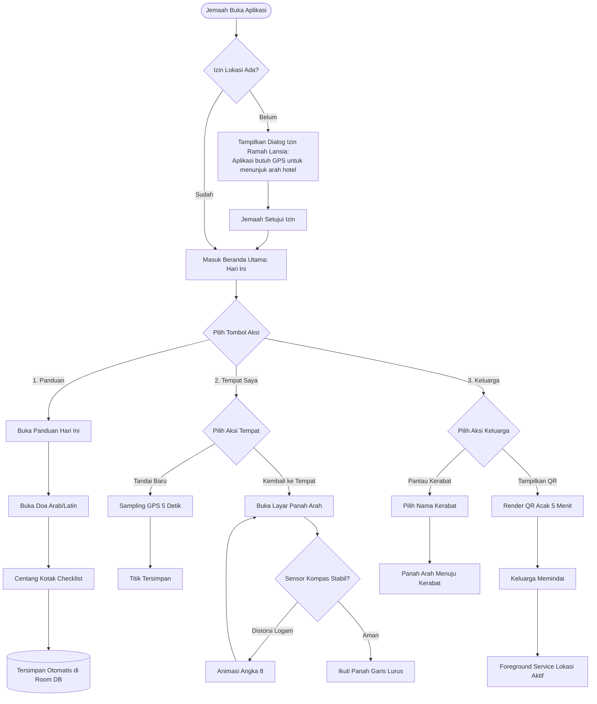

---

## 26. CONTENT GOVERNANCE DAN VALIDASI MATERI IBADAH

Materi panduan manasik haji dan umrah memiliki konsekuensi ibadah dan hukum syariat yang fundamental bagi jemaah. Kesalahan teks bacaan atau kekeliruan urutan rukun berpotensi merusak keabsahan ibadah haji jemaah. Oleh karena itu, sistem menetapkan tata kelola konten yang ketat (*Strict Content Governance*).

### 26.1 Siklus Hidup & Alur Validasi Konten (Content Lifecycle)

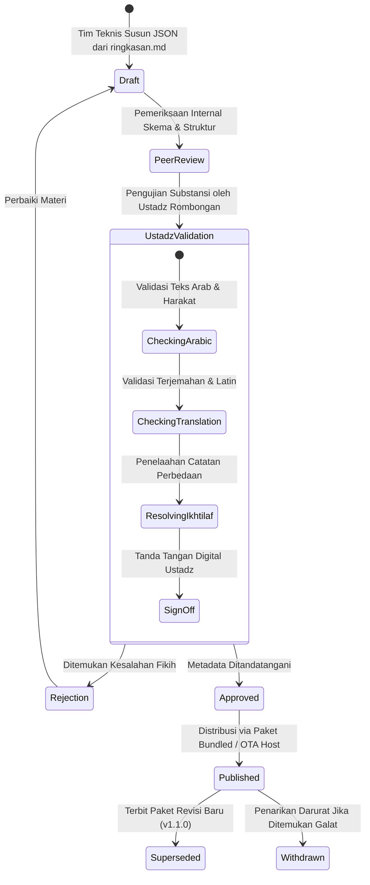

### 26.2 Penanganan 10 Titik Perbedaan Fikih (Neutrality Policy)
Sesuai amanat `ringkasan.md`, sistem mengadopsi prinsip: **Menyajikan Pilihan Rombongan sebagai Jalur Utama, tanpa Mengaburkan Pendapat Fikih yang Sah**:
1. **Keafdalan Haji Tamattu' (§B2):** Alur standar aplikasi memandu Haji Tamattu' (pilihan rombongan), namun pada halaman pengantar diberikan catatan ikhtilaf mazhab Syafii yang mengutamakan Haji Ifrad.
2. **Status Tahalul Umrah (§C1):** Tetap dimasukkan ke dalam checklist mutlak umrah, dengan catatan perbedaan status rukun (Ringkasan 3) vs wajib (Ringkasan 7).
3. **Pengulangan Doa di Safa & Marwah (§C5):** Panduan visual menyajikan kelonggaran pengulangan zikir 3 kali dan doa 2 atau 3 kali tanpa membebankan jemaah.
4. **Lafaz Zikir Safa (§C5):** Menampilkan lafaz masyhur *anjaza wa'dah* dengan teks alternatif *shadaqa wa'dah* di bagian catatan kaki.
5. **Doa Lampu Hijau Sa'i (§C5):** Doa *Rabbighfir warham...* disajikan sebagai sunah yang dianjurkan tanpa mewajibkan jemaah yang memiliki keterbatasan hafalan.
6. **Waktu Berangkat ke Mina 8 Zulhijah (§D2):** Jadwal disetel fleksibel (antara waktu Dhuha hingga sebelum Dzuhur).
7. **Salat Jamak di Mina pada Hari Tarwiyah (§D3):** Panduan menyajikan sunah utama (qasar tanpa jamak), namun menyertakan klausul kelonggaran jamak bagi rombongan yang mengalami hambatan pergerakan bus.
8. **Mabit di Arafah Malam 9 Zulhijah (§E1):** Menjelaskan sunah berangkat pagi hari 9 Zulhijah sekaligus mengakomodasi fakta logistik jemaah Indonesia yang diberangkatkan maktab sejak malam hari.
9. **Raml & Idtiba' Tawaf Ifadah (§G5):** Menyarankan jalan biasa karena mayoritas jemaah telah tahalul awal (mengenakan pakaian biasa).
10. **Penundaan Tawaf Ifadah Pasca-Mina (§I1):** Menyediakan toggle navigasi manasik 10 Zulhijah untuk jemaah yang langsung tawaf ifadah vs jemaah yang menundanya hingga 13 Zulhijah demi menjaga stamina fisik lansia.

### 26.3 Batas Tanggung Jawab Teknis & Disclaimer Fikih
Setiap awal modul panduan wajib menyertakan disclaimer hukum:
> *"Aplikasi ini adalah media bantu panduan manasik terstruktur berdasarkan ringkasan materi rombongan. Aplikasi ini bukan pengganti fatwa atau nasihat pembimbing ibadah langsung. Untuk keraguan dalam kondisi khusus (sakit, uzur syar'i, tertinggal rukun, atau dam), jemaah wajib berkonsultasi langsung dengan Ustadz Pembimbing Kloter."*

## 27. SECURITY ARCHITECTURE

Mengikuti metodologi keahlian *Security and Hardening*, keamanan aplikasi diposisikan sebagai batasan arsitektural mutlak (*fundamental constraint*), bukan sekadar lapisan tambahan. Setiap batas kepercayaan (*trust boundary*) dipetakan secara ketat untuk melindungi data lokasi sensitif jemaah haji, integritas materi manasik, dan otorisasi pelacakan keluarga.

### 27.1 Pemetaan Batas Kepercayaan & Permukaan Serangan (Trust Boundaries)

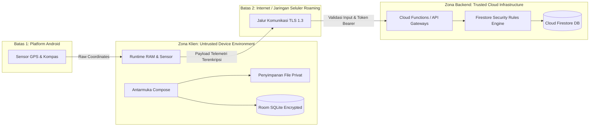

- **Trust Boundary 1 (Sensor & OS Input):** Nilai dari `Location` dan `SensorManager` dianggap data yang dapat mengalami interferensi magnetik dan jitter multipath. Data wajib disaring dan divalidasi batas kewajarannya sebelum dikomputasi.
- **Trust Boundary 2 (Jaringan Publik & Roaming):** Seluruh lalu lintas keluar masuk perangkat melintasi operator seluler asing di Arab Saudi yang berpotensi melakukan inspeksi atau manipulasi paket (*man-in-the-middle*). Wajib menerapkan TLS 1.3 dengan verifikasi sertifikat ketat.
- **Trust Boundary 3 (Cloud API & Database Gate):** Server memperlakukan seluruh payload request dari klien sebagai data yang berpotensi dimanipulasi (*hostile input*). Otorisasi relasi pelacakan ditegakkan langsung di level *Firestore Security Rules*.

### 27.2 Model Ancaman STRIDE (STRIDE Threat Model)

| Kategori Ancaman | Komponen Target | Vektor Serangan & Skenario Penyalahgunaan | Mitigasi Arsitektural & Hardening | Risiko Sisa (Residual Risk) |
| :--- | :--- | :--- | :--- | :--- |
| **S**poofing (Penyamaran) | Pendaftaran Pelacak & QR Code | Penyerang memindai atau mencegat foto QR jemaah lain untuk memalsukan identitas sebagai keluarga sah. | Token QR acak 256-bit *single-use* dengan TTL 5 menit. Penukaran token mengikat UID kriptografis Firebase Auth kedua pihak. | Rendah (Hanya jika penyerang memindai QR fisik langsung dalam jendela 5 menit). |
| **T**ampering (Manipulasi) | Berkas Konten Manasik OTA | Modifikasi paket JSON panduan ibadah di jalur transmisi untuk menyisipkan fatwa sesat atau doa palsu. | Setiap rilis konten menyertakan hash SHA-256 dan ditandatangani digital oleh kunci ustadz. Klien memverifikasi hash sebelum beralih. | Sangat Rendah (Kriptografi SHA-256 collision-resistant). |
| **R**epudiation (Penyangkalan) | Konsensus & Pencabutan Izin | Pengguna menyangkal telah memberikan izin berbagi lokasi atau menyangkal telah mencabutnya. | Dokumen `tracking_relations` mencatat epoch timestamp persetujuan, UID target, UID tracker, dan status mutakhir yang tidak dapat diubah klien. | Rendah. |
| **I**nformation Disclosure (Kebocoran Data) | Koordinat Lokasi Real-Time | Kebocoran koordinat jemaah kepada publik atau pihak ketiga yang tidak berhak. | Aturan Firestore membatasi akses baca koordinat: hanya pemilik dan tracker dengan relasi bertatus `ACTIVE` yang diizinkan membaca. TTL 24 jam. | Sangat Rendah. |
| **D**enial of Service (Kelumpuhan Sistem) | API Pembuatan Token QR | Panggilan berulang ribuan kali per menit untuk menghabiskan kuota backend Cloud Functions. | Penerapan Rate Limiting pada Cloud Functions (maksimal 3 token baru per 15 menit per UID). Kuota Cloud Armor / Firebase App Check. | Rendah. |
| **E**levation of Privilege (Eskalasi Hak) | Akses Telemetri Jemaah Lain | Pelacak memanipulasi ID target pada request payload untuk melihat lokasi jemaah dari kloter lain (IDOR). | Validasi otorisasi serverless: Aturan Firestore memeriksa keberadaan dokumen relasi spesifik `targetUid_trackerUid` secara atomik. | Sangat Rendah (Insecure Direct Object Reference / IDOR dicegah total). |

### 27.3 Kontrol Pengerasan Sistem (Security Hardening Controls)

#### 27.3.1 Pengamanan Kunci dan Rahasia (Secrets Management)
1. **Zero Secret in Binary:** Tidak ada secret server (seperti Firebase Service Account Keys, Private Keys, atau database credentials) yang dikompilasi ke dalam berkas APK. Berkas `google-services.json` hanya berisi identitas klien publik.
2. **Pengelolaan Keystore Rilis Mandiri (Offline Hardware Keystore):** Berkas keystore penandatanganan APK produksi disimpan dalam perangkat keras terenkripsi (USB Hardware Key offline) dengan cadangan terpisah pada 2 brankas fisik yang berbeda. Keystore dilarang diunggah ke repository git.
3. **R8/ProGuard Obfuscation:** Seluruh kode sumber release APK diobfuskasi untuk mempersulit dekompilasi balik (`minifyEnabled true`, `shrinkResources true`). Seluruh panggilan log debug (`Log.d`, `Log.v`) dihapus otomatis saat build release.

#### 27.3.2 Pengamanan Penyimpanan Lokal & Jaringan
1. **Network Security Config:** Memaksa komunikasi HTTPS murni (`cleartextTrafficPermitted="false"`) dan menolak seluruh lalu lintas HTTP biasa:
   ```xml
   <network-security-config>
       <base-config cleartextTrafficPermitted="false">
           <trust-anchors>
               <certificates src="system" />
           </trust-anchors>
       </base-config>
   </network-security-config>
   ```
2. **Pembersihan Log Sensitif (No PII/Location Logging):** Dilarang keras mencetak koordinat lintang/bujur, token QR, atau identitas pengguna ke dalam log konsol Android (`Logcat`), guna mencegah pembacaan data oleh aplikasi pihak ketiga berizin `READ_LOGS`.

---

## 28. PRIVACY DAN COMPLIANCE

Kebijakan privasi dirancang dengan pendekatan **Privacy-by-Design** dan kepatuhan terhadap regulasi pelindungan data pribadi nasional maupun internasional.

### 28.1 Inventarisasi dan Klasifikasi Data (Data Inventory & Classification)

| Entitas Data | Klasifikasi Data | Dasar Pemrosesan Hukum | Lokasi Penyimpanan | Retensi & Masa Berlaku | Dampak Jika Bocor |
| :--- | :--- | :--- | :--- | :--- | :--- |
| **Koordinat Lokasi Real-Time** | Data Pribadi Spesifik / Sensitif | Persetujuan Eksplisit (*Explicit Consent*) | Cloud Firestore (Hanya 1 titik terakhir) | Maksimal 24 Jam (TTL Otomatis) | Tinggi (Pelacakan fisik jemaah) |
| **Token Pairing QR** | Kunci Sesi Kriptografis | Kepentingan Pelaksanaan Fungsi | Memory Klien & Firestore | 5 Menit (300 detik) | Rendah (Hangus otomatis) |
| **Relasi Pelacakan Keluarga** | Data Pribadi Umum | Persetujuan Tertulis Dua Pihak | Cloud Firestore | Maksimal 40 Hari (Musim Haji) | Sedang (Pemetaan hubungan keluarga) |
| **Checklist & Progres Manasik**| Data Ibadah Pribadi | Kepentingan Pribadi Pengguna | Lokal SQLite (Room) | Sepanjang Aplikasi Terpasang | Sangat Rendah |
| **Tempat Tersimpan (Hotel/Pintu)**| Data Preferensi Navigasi | Kepentingan Pribadi Pengguna | Lokal SQLite (Room) | Sepanjang Aplikasi Terpasang | Rendah |

### 28.2 Model Persetujuan Bermakna (Consent-First Model)
Aplikasi membedakan secara tegas antara **Izin Sistem Operasi Android** dan **Persetujuan Berbagi Lokasi kepada Kerabat**:
- Izin Android (`ACCESS_FINE_LOCATION`) hanya memberikan hak teknis kepada aplikasi untuk membaca sensor GPS perangkat.
- Persetujuan Berbagi Lokasi adalah persetujuan independen di mana jemaah secara sadar menampilkan QR code kepada kerabat tertentu. Jemaah dapat mencabut izin berbagi lokasi kapan saja tanpa harus mematikan GPS ponselnya.

### 28.3 Hak Subjek Data: Pembersihan Total (Right to be Forgotten)
Aplikasi menyediakan tombol satu ketukan "Hapus Seluruh Data Saya" yang mengeksekusi prosedur pembersihan end-to-end:
1. Menghapus seluruh tabel basis data Room lokal (`saved_places`, `checklist_progress`, `location_sync_queue`).
2. Menghapus berkas konten cache dan pengaturan preferensi lokal.
3. Memanggil Cloud Function `purgeUserData()` untuk menghapus identitas anonim di Firebase Auth, dokumen relasi di Firestore, dan dokumen koordinat lokasi tanpa sisa.

### 28.4 Kepatuhan Regulasi (Compliance Checklist)
- **UU No. 27 Tahun 2022 tentang Pelindungan Data Pribadi (UU PDP Indonesia):**
  - Pemrosesan data lokasi spesifik didasarkan pada persetujuan eksplisit yang sah (Pasal 20 & 22).
  - Terdapat mekanisme penarikan kembali persetujuan secara mudah dan seketika (Pasal 40).
  - Penghapusan data pribadi dilakukan setelah masa retensi berakhir atau atas permintaan pemilik data (Pasal 43).
- **Regulasi Komunikasi & Data Arab Saudi (CITC / KSA Personal Data Protection Law):**
  - Aplikasi tidak mengumpulkan rekaman video/suara tanpa izin di tempat ibadah.
  - Data telemetri murni digunakan untuk keselamatan jemaah dan pencegahan jemaah terpisah, tanpa komersialisasi data.
- **Kebijakan Google Play Protect & Android Sideloading (FAQ 30 September 2026):**
  - Sertifikat penandatanganan APK didaftarkan pada konsol pengembang resmi (Google Developer Console) jalur *Full Distribution* untuk mencegah pemblokiran sistem keamanan Play Protect pada Android 15/16.

---

## 29. TESTING STRATEGY

Strategi pengujian mengadopsi model **Piramida Pengujian (Testing Pyramid)** komprehensif untuk memastikan aplikasi stabil di bawah kondisi jaringan buruk, suhu ekstrem, dan perangkat keras dengan spesifikasi minimum.

### 29.1 Piramida Pengujian Sistem

```
                 / \
                /   \
               / E2E \       10% (Uji Lapangan, Uji Baterai, & Uji Lansia Fisik)
              /-------\
             / Integr. \     30% (Room Migration, Fused Location, Sensor Fusi, API)
            /-----------\
           /  Unit Test  \   60% (Kalkulasi Hijriah, Great Circle, Parser JSON, VM)
          +---------------+
```

1. **Unit Testing (60%):** Menguji logika matematis dan bisnis murni tanpa emulator Android:
   - Kalkulasi tanggal Umm al-Qura dan penerapan manual offset (`HijriCalendarEngineTest`).
   - Formula trigonometri bearing target dan normalisasi derajat panah (`BearingCalculatorTest`).
   - Validasi skema JSON konten manasik dan deteksi kegagalan hash SHA-256 (`ContentIntegrityTest`).
   - State management ViewModel dengan coroutine TestScope (`GuideViewModelTest`, `PlacesViewModelTest`).
2. **Integration Testing (30%):** Menguji interaksi antar-komponen platform Android dan backend:
   - Pengujian migrasi basis data Room SQLite dan integritas tabel virtual FTS4.
   - Pengujian emulasi sensor rotasi dan kompensasi deklinasi magnetik.
   - Pengujian transaksi atomik Cloud Firestore via Firebase Local Emulator Suite.
3. **End-to-End & Field Testing (10%):** Pengujian sistem nyata pada perangkat fisik target (Xiaomi, Oppo, Vivo, Samsung):
   - Uji konsumsi daya baterai menggunakan *Battery Historian* selama 4 jam berjalan kaki.
   - Uji ketahanan offline penuh (Airplane mode) saat eksekusi panduan dan navigasi tempat.
   - Uji keterbacaan antarmuka dan kemudahan navigasi bersama pengguna lansia nyata.

---

## 30. DETAILED TEST CASES

Tabel kasus uji mencakup skenario normal, batas (*boundary*), negatif, dan kegagalan sistem:

| Test ID | Req ID | Skenario Pengujian | Prasyarat | Langkah-Langkah Pengujian | Data Uji | Hasil yang Diharapkan (Expected Result) | Prioritas |
| :--- | :--- | :--- | :--- | :--- | :--- | :--- | :---: |
| **TC-GUIDE-01**| FR-GUIDE-002 | Konversi Tanggal Hijriah Otomatis | Waktu sistem disetel ke tanggal Masehi 20 Mei 2027. | 1. Buka aplikasi.<br>2. Periksa tanggal di kartu beranda. | Tanggal: 2027-05-20, Zona: Asia/Riyadh. | Sistem menampilkan tepat "9 Zulhijah 1448 H". | **P0 (Kritis)** |
| **TC-GUIDE-02**| FR-GUIDE-003 | Penyesuaian Manual Tanggal Hijriah | Aplikasi menampilkan 9 Zulhijah. | 1. Buka Pengaturan.<br>2. Geser offset ke +1 hari.<br>3. Kembali ke Beranda. | Offset: +1 Hari. | Beranda berubah menampilkan kegiatan 10 Zulhijah (Hari Nahar) tanpa crash. | **P1 (Tinggi)** |
| **TC-GUIDE-03**| FR-GUIDE-007 | Pencarian Cepat Offline Kata Kunci Fikih | Perangkat dalam mode pesawat (Offline). | 1. Buka menu pencarian.<br>2. Ketik kata "hadyu". | Query: "hadyu". | Hasil pencarian muncul dalam < 80ms, menampilkan ayat/hadits dan tata cara hadyu. | **P1 (Tinggi)** |
| **TC-PLACE-01**| FR-PLACE-001 | Stabilisasi GPS Multi-Sampling | Berada di area terbuka, sinyal GPS aktif. | 1. Ketuk "Tandai Tempat Ini".<br>2. Amati progress bar sampling selama 3 detik. | 5 Sampel GPS dengan akurasi bervariasi (15m, 8m, 6m, 12m, 7m). | Sistem mengeliminasi nilai terburuk dan menyimpan median akurasi (~7 meter). | **P0 (Kritis)** |
| **TC-PLACE-02**| FR-PLACE-005 | Deteksi Degradasi GPS di Dalam Gedung | Pengguna berjalan masuk ke dalam basement Masjidil Haram. | 1. Buka layar panah arah.<br>2. Amati indikator akurasi sensor. | GPS accuracy melonjak hingga 45 meter. | Indikator sensor berubah merah; muncul peringatan: "Akurasi Rendah di Dalam Gedung". | **P1 (Tinggi)** |
| **TC-PLACE-03**| FR-PLACE-006 | Deteksi Distorsi Magnetik & Dialog Kalibrasi | Perangkat didekatkan ke tiang baja atau medan magnet tinggi. | 1. Buka layar kompas.<br>2. Picu event sensor `SENSOR_STATUS_UNRELIABLE`. | Nilai status sensor akurasi = 0. | Muncul modal panduan gerak angka 8; kompas tidak crash atau berputar liar. | **P1 (Tinggi)** |
| **TC-TRACK-01**| FR-TRACK-001 | Pembuatan Token QR Sekali Pakai | Koneksi internet aktif. | 1. Buka menu Bagikan Lokasi.<br>2. Amati QR code dan timer hitung mundur. | Permintaan token baru. | QR ter-render; timer 5:00 mulai menghitung mundur; token berstatus PENDING di server. | **P0 (Kritis)** |
| **TC-TRACK-02**| FR-TRACK-001 | Kedaluwarsa Token QR Setelah 5 Menit | QR code dibiarkan aktif selama lebih dari 300 detik. | 1. Tunggu hingga timer mencapai 00:00.<br>2. Pelacak mencoba memindai QR. | Token berumur 301 detik. | Pemindaian ditolak server dengan kode error `TOKEN_EXPIRED`; QR ditutup otomatis. | **P0 (Kritis)** |
| **TC-TRACK-03**| FR-TRACK-002 | Pencegahan Klaim Token Berulang (Replay Attack)| Token QR telah berhasil diklaim oleh Pelacak A. | 1. Pelacak B mencoba memindai QR code yang sama. | Token berstatus `CLAIMED`. | Transaksi Firestore menolak klaim; muncul error `TOKEN_ALREADY_USED`. | **P0 (Kritis)** |
| **TC-TRACK-04**| FR-TRACK-005 | Pencabutan Izin Seketika oleh Target | Relasi pelacakan aktif berjalan. | 1. Pihak target menekan tombol "Cabut Izin" untuk Pelacak A. | Aksi pencabutan di UI. | Relasi berubah menjadi `REVOKED`; Pelacak A seketika kehilangan akses koordinat. | **P0 (Kritis)** |
| **TC-TRACK-05**| FR-TRACK-006 | Antrean Offline Telemetri Lokasi | Layanan lokasi aktif, paket data ponsel dimatikan. | 1. Pengguna berjalan 500 meter.<br>2. Nyalakan kembali paket data. | 10 Sampel lokasi tertahan saat internet mati. | Lokasi disimpan di SQLite lokal; saat online, hanya sampel terakhir yang dikirim ke server. | **P1 (Tinggi)** |
| **TC-TRACK-06**| FR-TRACK-004 | Ketahanan Foreground Service Terhadap Reboot | Foreground Service lokasi aktif. | 1. Matikan dan nyalakan ulang ponsel (Reboot). | Perangkat restart. | Notifikasi aplikasi mengingatkan jemaah: "Buka aplikasi untuk melanjutkan pelacakan". | **P1 (Tinggi)** |
| **TC-BAT-01**  | NFR-BAT-001 | Pengujian Konsumsi Baterai 4 Jam Berjalan | Ponsel Xiaomi Redmi Note (Android 11), baterai 100%. | 1. Aktifkan pelacakan keluarga.<br>2. Jalankan simulasi pergerakan selama 4 jam. | Kecepatan jalan kaki rata-rata 1.1 m/s. | Total penurunan daya baterai <= 10% (rata-rata <= 2.5% per jam). | **P1 (Tinggi)** |
| **TC-DIST-01** | FR-DIST-002 | Integritas Pembaruan Konten JSON OTA | Tersedia rilis konten v1.1.0 di server statis. | 1. Aplikasi unduh berkas pembaruan.<br>2. Simulasikan bit korup pada checksum payload. | Checksum SHA-256 lokal != Checksum Manifest server. | Aplikasi menolak berkas; pembaruan dibatalkan; aplikasi tetap aman memakai konten v1.0.0. | **P0 (Kritis)** |
| **TC-PRIV-01** | FR-DIST-004 | Penghapusan Data Total (Right to be Forgotten) | Aplikasi memiliki data tempat, checklist, dan akun. | 1. Tekan "Hapus Seluruh Data Saya".<br>2. Konfirmasi pada dialog 2-langkah. | Permintaan purge data. | Seluruh data Room lokal kosong; dokumen Firebase Auth dan Firestore terhapus bersih. | **P0 (Kritis)** |

---

## 31. TECHNICAL DAN SECURITY AUDIT

Checklist audit teknis independen yang wajib dievaluasi dan ditandatangani sebelum rilis APK:

### 31.1 Checklist Audit Keamanan & Privasi
- [ ] **Zero Hardcoded Secrets:** Pemindaian repository git dengan alat *TruffleHog / Gitleaks* menunjukkan 0 secret atau API private key yang bocor.
- [ ] **Firestore Rules Coverage:** Seluruh koleksi Firestore memiliki aturan otorisasi tertutup (*deny-by-default*); tidak ada aturan `allow read, write: if true;`.
- [ ] **IDOR Protection:** Pengecekan otorisasi memastikan pengguna A tidak dapat melihat dokumen `/locations/{userIdB}` tanpa relasi aktif yang sah.
- [ ] **No PII in Logcat:** Audit kode memastikan tidak ada pencetakan koordinat GPS, token, atau nomor identitas ke Android log.
- [ ] **TLS 1.3 Enforcement:** Pengujian proksi Burp Suite membuktikan aplikasi menolak sambungan HTTP tidak terenkripsi (*cleartext traffic rejected*).

### 31.2 Checklist Kualitas Rekayasa & Platform Android
- [ ] **Android 14+ Foreground Service Compliance:** Deklarasi manifest memuat `android:foregroundServiceType="location"` dan notifikasi status bar tidak dapat di-swipe dismiss.
- [ ] **Offline Resilience:** Pengujian mode pesawat udara membuktikan seluruh modul panduan manasik, bacaan doa, pencarian, dan penandaan tempat dapat dibuka tanpa crash (*zero ANR / zero uncaught exceptions*).
- [ ] **Elderly Touch Target Compliance:** Seluruh tombol dan area sentuh terverifikasi minimal berdimensi $56 \times 56\text{ dp}$ pada *Android Studio Accessibility Scanner*.
- [ ] **ProGuard/R8 Obfuscation:** Berkas APK release yang dihasilkan terverifikasi telah diobfuskasi dan seluruh simbol nama class domain telah di-shrink.
- [ ] **Keystore Signing Verification:** APK ditandatangani menggunakan sertifikat penandatanganan resmi (*APK Signature Scheme v2 & v3*) yang dicadangkan di 2 brankas offline terpisah.

## 32. IMPLEMENTATION ROADMAP

Mengikuti metodologi **Incremental Implementation**, rencana implementasi dipecah menjadi irisan vertikal tipis (*thin vertical slices*) yang dikelompokkan dalam 8 fase terurut secara dependensi (*dependency-aware*):

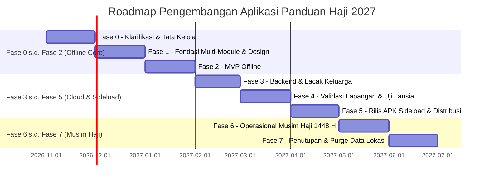

### 32.1 Rincian Fase Pengembangan
1. **Fase 0 — Klarifikasi dan Persiapan (Nov – Des 2026):**
   - *Tujuan:* Mengonfirmasi 6 keputusan terbuka (OD-001 s.d. OD-006) bersama pemilik produk dan ustadz.
   - *Deliverables:* Akun Google Developer *Full Distribution* ($25) terverifikasi, penunjukan ustadz penanggung jawab, dan baseline konten `content_v1.0.0.json`.
   - *Definition of Done (DoD):* Berkas JSON tervalidasi 100% dari `ringkasan.md` dan sertifikat keystore rilis diamankan di 2 brankas offline.
2. **Fase 1 — Fondasi Aplikasi & Design System (Des 2026 – Jan 2027):**
   - *Tujuan:* Menyiapkan arsitektur multi-module Gradle, dependency injection (Hilt), dan token Compose ramah lansia.
   - *Deliverables:* Modul `:core:designsystem`, `:core:database`, `:core:model`, dan pipeline build CI awal.
   - *DoD:* `./gradlew build` sukses, rasio kontras warna $\ge 7:1$, dan touch target $56\text{ dp}$ terverifikasi via UI tests.
3. **Fase 2 — MVP Offline: Panduan & Penandaan Tempat (Jan – Feb 2027):**
   - *Tujuan:* Menghadirkan aplikasi mandiri yang sudah bernilai tinggi tanpa memerlukan internet atau server.
   - *Deliverables:* Mesin kalender Hijriah Umm al-Qura + manual offset, beranda "Hari Ini", checklist Room, pencarian FTS4, GPS multi-sampling, dan kompas panah Compose.
   - *DoD:* 100% fungsionalitas berjalan lancar pada *Airplane Mode*, 0 crash pada pengujian rotasi layar dan backgrounding.
4. **Fase 3 — Backend & Pelacakan Keluarga (Feb – Mar 2027):**
   - *Tujuan:* Membangun sistem telemetri lokasi berbasis persetujuan QR code.
   - *Deliverables:* Firebase Auth Anonymous, Cloud Functions pertukaran token 5 menit, Firestore Security Rules, Android Foreground Service bertipe lokasi, dan antrean offline SQLite.
   - *DoD:* Uji skenario klaim ganda (*replay attack*) tertolak, penarikan izin seketika berhasil, dan pembersihan data berfungsi.
5. **Fase 4 — Validasi Lapangan & Uji Pengguna Lansia (Mar – Apr 2027):**
   - *Tujuan:* Menguji ketahanan fisik aplikasi pada perangkat jemaah riil (Xiaomi, Oppo, Vivo, Samsung).
   - *Deliverables:* Laporan benchmark baterai 4 jam, perbaikan instruksi whitelist baterai OEM, dan penyesuaian teks hasil uji keterbacaan lansia.
   - *DoD:* Konsumsi daya $\le 2.5\%$/jam saat aktif bergerak, zero silent kill service oleh OS vendor.
6. **Fase 5 — Rilis APK & Distribusi Sideload (Apr – Mei 2027):**
   - *Tujuan:* Mendistribusikan APK bertanda tangan kepada jemaah sebelum keberangkatan kloter pertama.
   - *Deliverables:* Halaman web HTTPS unduhan APK, kode QR cetak pada buku panduan fisik rombongan, checksum SHA-256 publik, dan panduan instalasi bergambar.
   - *DoD:* APK terpasang pada minimal 100 perangkat jemaah uji tanpa peringatan blokir Play Protect.
7. **Fase 6 — Operasional Musim Haji 1448 H (Mei – Juni 2027):**
   - *Tujuan:* Menjaga keandalan layanan selama fase Armuzna (Arafah, Muzdalifah, Mina).
   - *Deliverables:* Monitoring performa serverless Firebase, rilis patch konten OTA jika ada pengumuman mendadak otoritas Saudi.
   - *DoD:* Uptime backend 99.9%, zero insiden kebocoran koordinat jemaah.
8. **Fase 7 — Penutupan Musim Haji & Penghapusan Data (Juni – Juli 2027):**
   - *Tujuan:* Mengakhiri operasional dan menghapus seluruh data sensitif (Zero Data Liability).
   - *Deliverables:* Eksekusi skrip pembersihan Cloud Functions untuk menghapus seluruh dokumen `/locations` dan `/tracking_relations`.
   - *DoD:* Basis data telemetri di server bersih 100%, laporan evaluasi tahunan diterbitkan.

---

## 33. AI CODING AGENT TASK BREAKDOWN (THIN VERTICAL SLICES)

Rincian tugas implementasi terstruktur untuk dieksekusi secara berurutan oleh AI Coding Agent maupun pengembang manusia dengan prinsip **Satu Tugas, Satu Irisan Lengkap**:

```
+----------------------------------------------------------------------------------------------------------------------+
|                                          AI CODING AGENT TASK MATRIX                                                 |
+---------+-----------------------------------------+---------------------------------+--------------------------------+
| Task ID | Nama Tugas / Irisan Vertikal            | Modul & Berkas Utama Terdampak  | Perintah Verifikasi Otomatis   |
+---------+-----------------------------------------+---------------------------------+--------------------------------+
| TASK-01 | Setup Multi-Module & Design System      | :core:designsystem (Tokens.kt)  | ./gradlew :core:designsystem:test
| TASK-02 | Model Domain Manasik & Parser JSON      | :core:model, :core:common       | ./gradlew :core:model:test     |
| TASK-03 | Mesin Kalender Hijrah & Date Override   | :core:common (HijriEngine.kt)   | ./gradlew :core:common:test    |
| TASK-04 | Room DB: Checklist & FTS4 Search Table  | :core:database (AppDatabase.kt) | ./gradlew :core:database:test  |
| TASK-05 | Feature Guide: Beranda "Hari Ini" & UI  | :feature:guide (HomeScreen.kt)  | ./gradlew :feature:guide:test  |
| TASK-06 | Feature Guide: Bacaan Doa & Detail Step | :feature:guide (DoaScreen.kt)   | ./gradlew :feature:guide:test  |
| TASK-07 | Room DB: Saved Places & DAOs            | :core:database (PlacesDao.kt)   | ./gradlew :core:database:test  |
| TASK-08 | GPS Multi-Sampling Averaging Engine     | :feature:places (GpsEngine.kt)  | ./gradlew :feature:places:test |
| TASK-09 | Fusi Sensor Rotasi Kompas & True Azimuth| :feature:places (CompassNav.kt) | ./gradlew :feature:places:test |
| TASK-10 | Feature Places: UI Kompas Panah Compose | :feature:places (CompassScreen) | ./gradlew :feature:places:test |
| TASK-11 | Firebase Auth Anonymous & Token DTO     | :core:network (FirebaseAuth.kt) | ./gradlew :core:network:test   |
| TASK-12 | Cloud Functions: Pairing Token Exchange | /backend/functions (index.ts)   | npm --prefix backend test      |
| TASK-13 | Firestore Security Rules Penegakan RBAC | /backend/firestore.rules        | firebase emulators:exec npm test
| TASK-14 | Android Location Foreground Service     | :feature:tracking (Service.kt)  | ./gradlew :feature:tracking:test
| TASK-15 | Offline Location Queue & Sync Manager   | :core:database, :feature:track  | ./gradlew :feature:tracking:test
| TASK-16 | Feature Tracking: QR Share & Scan UI    | :feature:tracking (QrScreen.kt) | ./gradlew :feature:tracking:test
| TASK-17 | OTA Content Update Manager & Hash Check | :feature:settings (OtaEngine.kt)| ./gradlew :feature:settings:test
| TASK-18 | E2E Purge Data: Right to be Forgotten   | :feature:settings, :backend     | ./gradlew connectedAndroidTest |
+---------+-----------------------------------------+---------------------------------+--------------------------------+
```

### Format Spesifikasi Setiap Task (Contoh Spesifikasi Operasional TASK-08):
- **Task ID:** `TASK-08`
- **Tujuan:** Mengimplementasikan mesin pengambil sampel GPS berulang (*multi-sampling*) selama 3 detik dan menghitung median koordinat untuk stabilisasi titik tempat tersimpan.
- **Prasyarat:** `TASK-07` (Room Places Database) selesai dan lolos tes.
- **Berkas Terdampak:** `:feature:places/src/main/java/com/haji2027/places/domain/GpsAveragingEngine.kt`.
- **Perubahan yang Diharapkan:** Kelas `GpsAveragingEngine` mengeksekusi flow sampling via `FusedLocationProviderClient`, mengumpulkan minimal 5 sampel dalam 3 detik, memfilter sampel dengan galat $>25\text{m}$, dan merata-ratakan koordinat lintang/bujur.
- **Acceptance Criteria:** Pengujian unit membuktikan bahwa jika terdapat 5 sampel koordinat acak, sistem mengembalikan nilai median dengan radius akurasi terhitung secara deterministik.
- **Test yang Harus Dibuat:** `GpsAveragingEngineTest.kt` (menguji skenario normal, skenario sinyal buruk, dan batas timeout sampling).
- **Dependensi Task:** Bergantung pada `:core:model` dan `:core:database`.
- **Risiko Regresi:** Kebocoran listener GPS jika coroutine dibatalkan di tengah sampling (wajib menggunakan `awaitClose` pada `callbackFlow`).
- **Instruksi Verifikasi:** Jalankan `./gradlew :feature:places:test --tests "GpsAveragingEngineTest"`.

---

## 34. CI/CD DAN RELEASE PIPELINE

Pipeline otomatisasi menjamin bahwa setiap perubahan kode terverifikasi secara statis, bebas dari kerentanan dependensi, dan menghasilkan binary APK yang dapat direproduksi (*reproducible builds*):

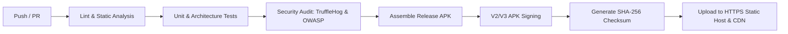

1. **Pull Request Quality Gates:**
   - Deteksi perubahan format dan pelanggaran kode Kotlin (`ktlintCheck`).
   - Eksekusi 100% unit tests (`./gradlew testDebugUnitTest`).
   - Pemindaian rahasia dalam commit (`gitleaks detect --source . -v`).
2. **Build Reproducibility:**
   - Seluruh dependensi Gradle dikunci versinya via Gradle Dependency Lockfiles (`--write-locks`).
   - Menggunakan OpenJDK 17 LTS resmi pada container CI yang deterministik.
3. **Artifact Signing:**
   - APK release ditandatangani menggunakan alat `apksigner` dengan skema v2, v3, dan v4.
   - Perhitungan hash kriptografis SHA-256 secara otomatis: `sha256sum app-release.apk > app-release.apk.sha256`.

---

## 35. APK DISTRIBUTION (SIDELOADING ARCHITECTURE)

Sesuai ketetapan `Konsep2.md`, distribusi aplikasi tidak menggunakan Google Play Store guna menghindari kewajiban *closed testing* 14 hari 20 tester. Distribusi dilakukan secara mandiri dengan arsitektur web statis terkelola:

### 35.1 Arsitektur Distribusi Mandiri
1. **Laman Unduhan Resmi (HTTPS Static Host):**
   - URL: `https://unduh.panduanhaji2027.org` (dihosting via GitHub Pages / Cloudflare Pages dengan sertifikat TLS otomatis).
   - Menampilkan tombol unduh APK langsung, label nomor versi aktif, ukuran berkas (MB), tanggal rilis, dan hash SHA-256.
2. **Distribusi Fisik via Kode QR:**
   - Kode QR yang mengarah langsung ke tautan unduh APK dicetak pada buku saku panduan manasik rombongan dan dibagikan di grup komunikasi jemaah sebelum berangkat ke asrama haji.
3. **Panduan Pemasangan Sumber Tidak Dikenal (Unknown Sources Guide):**
   - Halaman unduh menyertakan panduan bergambar langkah demi langkah:
     - *"Buka file APK yang telah diunduh"* → *"Pilih Izinkan dari Sumber Ini / Tetap Pasang"* → *"Selesai"*.
4. **Pendampingan Pemasangan Sebelum Keberangkatan:**
   - Sesuai prinsip produk, proses pemasangan APK dan pairing keluarga diselesaikan saat bimbingan manasik tatap muka di tanah air dibantu oleh tim pendamping rombongan atau keluarga muda.

---

## 36. DEPLOYMENT ARCHITECTURE

Sistem memisahkan konfigurasi secara tegas antara lingkungan pengembangan, pengujian, dan produksi:

```
+----------------------------------------------------------------------------------------+
|                                ENVIRONMENT MATRIX                                      |
+---------------------+--------------------------+---------------------------------------+
| Parameter           | Staging / QA Environment | Production Environment (Haji 2027)    |
+---------------------+--------------------------+---------------------------------------+
| Application ID      | com.haji2027.app.staging | com.haji2027.app                      |
| APK Signing         | Staging Keystore (CI)    | Production Keystore (Offline Hardware)|
| Firebase Project    | haji2027-staging-app     | haji2027-prod-app                     |
| Firestore Rules     | Test Mode / Permissive   | Strict RBAC Consent Rules             |
| Proguard / R8       | Obfuscate Disabled       | Full R8 Minification + Obfuscation    |
| Logging / Telemetry | Logcat Verbose + Crashlyt| Stripped Logs (No Lat/Lng in logs)    |
| Static Host OTA     | https://dev-cdn...       | https://unduh.panduanhaji2027.org     |
+---------------------+--------------------------+---------------------------------------+
```

---

## 37. MONITORING DAN INCIDENT RESPONSE

### 37.1 Observabilitas Tanpa Kebocoran Privasi (Privacy-Preserving Telemetry)
- **Metrik Bebas PII:** Sistem hanya memantau metrik operasional agregat via Firebase Crashlytics dan Firebase Performance Monitoring:
  - Angka *Crash-Free Users* harian (Target: $\ge 99.8\%$).
  - Latensi panggilan Cloud Functions penukaran token QR (Target: $p95 \le 1200\text{ms}$).
  - Volume panggilan rate-limited per jam.
- **Larangan Telemetri Koordinat:** Dilarang mencatat koordinat lintang/bujur atau token ke dalam custom breadcrumbs Crashlytics.

### 37.2 Klasifikasi Insiden & Runbook Respon
| Tingkat Insiden | Definisi & Dampak | Respon Maksimal (SLA) | Prosedur Penanganan Darurat |
| :--- | :--- | :--- | :--- |
| **SEV-1 (Kritis)** | Seluruh fungsi pelacakan down di Armuzna / Kesalahan fatal pada teks rukun wukuf. | <= 15 Menit | 1. Tim teknis terbitkan rilis darurat paket konten OTA.<br>2. Umumkan panduan manual di grup ketua kloter.<br>3. Bypass backend jika diperlukan. |
| **SEV-2 (Tinggi)** | Kegagalan pembuatan token QR / Pembaruan APK gagal dipasang pada merek HP tertentu. | <= 1 Jam | 1. Rollback Cloud Functions ke versi sebelumnya.<br>2. Perbarui panduan izin instalasi pada laman unduh web. |
| **SEV-3 (Sedang)**| Perbedaan tanggal Hijriah lokal di HP jemaah dengan penetapan Kerajaan Arab Saudi. | <= 2 Jam | Instruksikan jemaah melalui pengumuman rombongan untuk menggunakan fitur "Geser Tanggal Manual (+/- hari)". |

---

## 38. BACKUP DAN DISASTER RECOVERY

1. **Recovery Point Objective (RPO):**
   - Konten Panduan: RPO = 0 (Tersimpan permanen di repository git dan berkas bundled APK).
   - Relasi Pelacakan: RPO $\le 1\text{ jam}$ (Backup terjadwal Firestore harian).
2. **Recovery Time Objective (RTO):**
   - RTO $\le 2\text{ jam}$ untuk pemulihan infrastruktur serverless Firebase.
3. **Disaster Recovery Keystore Rilis:**
   - Keystore produksi dicadangkan dalam bentuk *encrypted archive* (AES-256) pada 2 media fisik terisolasi (Cold USB Storage). Jika mesin CI/CD musnah, keystore dapat dipulihkan secara offline untuk menandatangani berkas APK rilis darurat.

---

## 39. COST ESTIMATION (ANALISIS KELAYAKAN BIAYA)

Biaya infrastruktur dihitung berdasarkan 3 skenario realistis penggunaan selama 40 hari masa operasional haji (Mei – Juni 2027) menggunakan layanan Firebase Serverless:

```
+----------------------------------------------------------------------------------------------------+
|                                    ESTIMASI BIAYA CLOUD HAJI 2027                                  |
+--------------------------+-----------------------+------------------------+------------------------+
| Komponen Biaya           | Skenario A (1 Kloter) | Skenario B (3 Kloter)  | Skenario C (Publik)    |
|                          | 400 Jemaah            | 1.200 Jemaah           | 5.000 Jemaah           |
+--------------------------+-----------------------+------------------------+------------------------+
| Pendaftaran Google Dev   | $25 (Sekali Bayar)    | $25 (Sekali Bayar)     | $25 (Sekali Bayar)     |
| Firebase Authentication  | $0 (Bebas Biaya)      | $0 (Bebas Biaya)       | $0 (Bebas Biaya)       |
| Cloud Firestore Reads    | $0 (Dalam Free Tier)  | $0 (Dalam Free Tier)   | ~$4.50 / Bulan         |
| Cloud Firestore Writes   | $0 (Dalam Free Tier)  | ~$3.20 / Bulan         | ~$12.80 / Bulan        |
| Cloud Functions Invoc.   | $0 (Dalam Free Tier)  | $0 (Dalam Free Tier)   | ~$1.20 / Bulan         |
| Web Hosting APK (CDN)    | $0 (Cloudflare Free)  | $0 (Cloudflare Free)   | $0 (Cloudflare Free)   |
+--------------------------+-----------------------+------------------------+------------------------+
| TOTAL BIAYA 1 MUSIM HAJI | ~$25.00               | ~$28.20                | ~$43.50                |
+--------------------------+-----------------------+------------------------+------------------------+
```
*Kesimpulan Kelayakan:* Biaya operasional infrastruktur cloud serverless sangat rendah (< Rp 700.000 per musim haji) sehingga model distribusi aplikasi gratis murni bagi jemaah sangat layak (*financially viable*) dan dapat disubsidi penuh oleh kas rombongan/yayasan.

---

## 40. OPERATIONAL RUNBOOK MUSIM HAJI 2027

### 40.1 Periode Pra-Keberangkatan (H-60 s.d. H-1)
- [ ] Ustadz pembimbing merampungkan telaah fikih dan menandatangani metadata `content_v1.0.0.json`.
- [ ] Build release APK final, ditandatangani keystore produksi, dan diunggah ke `unduh.panduanhaji2027.org`.
- [ ] Cetak stiker/kartu saku berisi kode QR unduhan APK untuk seluruh koper jemaah.
- [ ] Simulasi instalasi massal dan pemasangan pairing barcode saat manasik akbar di tanah air.

### 40.2 Periode Puncak Haji (8 s.d. 13 Zulhijah 1448 H / Mei 2027)
- [ ] **Code Freeze Mutlak:** Dilarang melakukan update kode APK selama masa Armuzna (Arafah-Muzdalifah-Mina) kecuali insiden SEV-1.
- [ ] Sinkronisasi penetapan ru'yah 1 Zulhijah oleh Mahkamah Agung Kerajaan Arab Saudi. Jika ada pergeseran hari, terbitkan notifikasi penyesuaian manual offset (+/- hari).
- [ ] Pemantauan harian kuota penulisan Firestore telemetri pelacakan keluarga.

### 40.3 Periode Pasca-Haji & Penutupan (14 s.d. 30 Zulhijah 1448 H)
- [ ] Tanggal 30 Zulhijah: Layanan pelacakan otomatis dinonaktifkan di seluruh klien.
- [ ] Eksekusi Cloud Function `purgeHajjSeasonData()` untuk membersihkan seluruh dokumen relasi pelacakan dan koordinat jemaah dari database server.
- [ ] Penerbitan laporan evaluasi teknis dan pencadangan log performa untuk persiapan musim haji 2028.

---

## 41. REQUIREMENT TRACEABILITY MATRIX (RTM)

Matriks keterlacakan membuktikan bahwa setiap kebutuhan fungsional dan non-fungsional terhubung secara utuh dengan modul kode, skema data, API, dan kasus uji:

| Req ID | Deskripsi Kebutuhan | Komponen Modul | Entitas Data | Kontrak API | Test Case ID | Acceptance Criteria |
| :--- | :--- | :--- | :--- | :--- | :--- | :--- |
| **FR-ONB-001** | FTUX Tiga Langkah Lansia | `:feature:onboarding` | - | - | `TC-GUIDE-01` | Selesai dalam 3 layar, font >= 18sp. |
| **FR-ONB-004** | Whitelist Baterai OEM | `:feature:settings` | `UserPreferences` | - | `TC-BAT-01` | Mengarahkan ke menu setelan baterai vendor. |
| **FR-GUIDE-002**| Kalender Hijriah Umm al-Qura| `:core:common` | `Day` | - | `TC-GUIDE-01` | Menghitung 9 Zulhijah 1448 H secara presisi. |
| **FR-GUIDE-003**| Manual Date Override (+/-) | `:core:common` | `UserPreferences` | - | `TC-GUIDE-02` | Offset -3 s.d. +3 hari terkompensasi instan. |
| **FR-GUIDE-006**| Checklist Progres Persisten | `:core:database` | `ChecklistProgress`| - | `TC-GUIDE-01` | Status centang tidak terhapus saat reboot. |
| **FR-GUIDE-007**| Pencarian Offline FTS4 | `:core:database` | `guide_search_fts` | - | `TC-GUIDE-03` | Hasil pencarian teks muncul dalam < 80ms. |
| **FR-PLACE-001**| GPS Multi-Sampling Averaging | `:feature:places` | `SavedPlace` | - | `TC-PLACE-01` | Mengambil median dari 5 sampel koordinat. |
| **FR-PLACE-004**| Kompas Panah Terkompensasi | `:feature:places` | - | - | `TC-PLACE-01` | Koreksi deklinasi magnetik Makkah +2.8°. |
| **FR-PLACE-005**| Indikator Kejujuran Akurasi | `:feature:places` | `SavedPlace` | - | `TC-PLACE-02` | Hijau (<10m), Kuning (10-30m), Merah (>30m).|
| **FR-TRACK-001**| Token QR Acak 5 Menit | `:feature:tracking` | `PairingToken` | `POST /generateToken` | `TC-TRACK-01` | Token kedaluwarsa tepat setelah 300 detik. |
| **FR-TRACK-002**| Pairing Dua Arah Terpisah | `:feature:tracking` | `TrackingRelation` | `POST /claimToken` | `TC-TRACK-03` | Replay claim tertolak; izin satu arah. |
| **FR-TRACK-004**| Foreground Service Lokasi | `:feature:tracking` | `UserLocation` | `POST /updateLocation`| `TC-TRACK-06` | Persistent notification aktif di status bar. |
| **FR-TRACK-006**| Antrean Offline Telemetri | `:core:database` | `location_sync_queue`| `POST /updateLocation`| `TC-TRACK-05` | Maks 50 sampel FIFO; sync saat online. |
| **FR-DIST-002** | Pembaruan Konten OTA | `:feature:settings` | `OtaManifest` | `GET /manifest.json` | `TC-DIST-01` | Validasi hash SHA-256 sebelum swap aktif. |
| **FR-DIST-004** | Right to be Forgotten | `:feature:settings` | Seluruh Entitas | `POST /purgeUserData` | `TC-PRIV-01` | Seluruh data Room & Cloud terhapus bersih. |
| **NFR-BAT-001** | Baterai <= 2.5% / Jam | `:feature:tracking` | - | - | `TC-BAT-01` | Lolos benchmark Battery Historian 4 jam. |

---

## 42. GLOSSARY (DAFTAR ISTILAH TEKNIS DAN MANASIK)

### 42.1 Istilah Ibadah Manasik Haji & Umrah
- **Dam:** Denda yang wajib dibayar karena pelanggaran larangan ihram atau karena melaksanakan haji Tamattu'/Qiran (menyembelih hewan hadyu).
- **Fidyah:** Tebusan berupa memberi makan fakir miskin, berpuasa 3 hari, atau menyembelih kambing karena uzur saat melanggar larangan ihram.
- **Hari Nahar:** Hari ke-10 Zulhijah (Hari Raya Iduladha) saat pelaksanaan lempar Jumrah Aqabah, hadyu, tahalul, dan tawaf ifadah.
- **Hari Tarwiyah:** Hari ke-8 Zulhijah di mana jemaah mulai berihram haji dan disunahkan bermalam (*mabit*) di Mina sebelum ke Arafah.
- **Hari Tasyrik:** Tanggal 11, 12, dan 13 Zulhijah di Mina untuk bermalam dan melontar tiga jumrah (Ula, Wusta, Aqabah).
- **Idtiba':** Membuka bahu kanan bagi laki-laki saat tawaf dengan menyampirkan ujung kain ihram ke pundak kiri.
- **Miqat Makani:** Batas geografis yang tidak boleh dilewati oleh jemaah yang hendak haji/umrah tanpa mengenakan pakaian ihram dan berniat.
- **Nafar Awal:** Meninggalkan Mina lebih awal pada tanggal 12 Zulhijah sebelum terbenam matahari setelah melempar jumrah.
- **Nafar Tsani:** Menyempurnakan mabit di Mina hingga tanggal 13 Zulhijah dan melempar jumrah pada hari tersebut.
- **Raml:** Berjalan cepat dengan langkah pendek sambil menggerakkan bahu pada 3 putaran pertama tawaf (khusus laki-laki).
- **Tahalul Awal:** Berakhirnya sebagian larangan ihram setelah menyelesaikan 2 dari 3 amalan 10 Zulhijah (jumrah, cukur, atau tawaf).
- **Tahalul Tsani (Sempurna):** Berakhirnya seluruh larangan ihram, termasuk hubungan suami-istri, setelah menyelesaikan seluruh rukun.
- **Wukuf:** Berdiam diri di Padang Arafah pada 9 Zulhijah setelah zawal (waktu Zuhur) hingga terbenam matahari; rukun haji paling utama.
- **Zawal:** Waktu tergelincirnya matahari dari titik tengah langit ke arah barat, menandai masuknya waktu salat Zuhur.

### 42.2 Istilah Arsitektur Perangkat Lunak & Sistem
- **As-the-crow-flies:** Penunjuk jarak garis lurus langsung secara matematis tanpa memperhitungkan belokan jalan, gedung, atau kontur fisik.
- **Decoupled Architecture:** Pola arsitektur perangkat lunak di mana antarmuka, logika bisnis, dan penyimpanan data terisolasi mandiri.
- **Fused Location Provider:** API geolokasi cerdas Android yang menggabungkan sinyal GPS, Wi-Fi seluler, dan akselerometer untuk efisiensi daya.
- **GeomagneticField:** Kelas Android SDK untuk menghitung deklinasi magnetik Bumi (selisih sudut antara Kutub Utara Magnetik dan Kutub Utara Sejati).
- **Offline-First:** Filosofi desain perangkat lunak yang memastikan aplikasi dapat beroperasi normal tanpa dependensi koneksi internet.
- **Replay Attack:** Serangan keamanan di mana transmisi data yang valid ditangkap dan dikirim ulang oleh pihak musuh untuk menipu sistem.
- **Sideloading:** Pemasangan paket aplikasi Android (APK) secara langsung dari berkas penyimpanan di luar Google Play Store.
- **Time-to-Live (TTL):** Mekanisme penghapusan otomatis data dalam database setelah mencapai batas waktu retensi yang telah ditentukan.

---

## 43. REFERENCES DAN SOURCE REGISTER

1. **`Konsep2.md` (v2):** Dokumen visi produk, arsitektur awal, analisis 3 pilar fungsional, dan register keputusan terbuka.
2. **`ringkasan.md`:** Ringkasan gabungan 8 materi manasik haji dan umrah, mencakup telaah hadits Jabir, tata cara harian, dan 10 catatan perbedaan fikih.
3. **Android Developers Documentation (Google, 2026):**
   - *Android Developer Verification FAQ:* Ketentuan rilis APK sideload di Indonesia dan regulasi toko aplikasi per 30 September 2026.
   - *Foreground Service Types:* Kepatuhan deklarasi layanan lokasi latar belakang pada Android 14+ (API Level 34+).
   - *SensorManager & GeomagneticField:* Standar fusi sensor rotasi perangkat mobile.
4. **Undang-Undang Republik Indonesia No. 27 Tahun 2022 tentang Pelindungan Data Pribadi (UU PDP).**
5. **OWASP Mobile Application Security Verification Standard (MASVS v2.0):** Standar pengerasan keamanan aplikasi Android mandiri.

---

## 44. FINAL READINESS CHECKLIST

Evaluasi akhir kepatuhan dokumen System Design Document terhadap seluruh kriteria keberhasilan yang disyaratkan:

- [x] **Kedua Berkas Sumber Terbaca Penuh:** `Konsep2.md` dan `ringkasan.md` dianalisis menyeluruh tanpa ada bagian yang dihilangkan.
- [x] **Pemetaan Kebutuhan Fungsional Lengkap:** 25+ Functional Requirements memiliki ID stabil (`FR-GUIDE-xxx`, `FR-PLACE-xxx`, `FR-TRACK-xxx`).
- [x] **Strategi Fikih Independen:** 10 catatan perbedaan fikih dimodelkan secara terstruktur di skema JSON tanpa memaksakan fatwa baru.
- [x] **Non-Functional Requirements Terukur:** NFR performa startup, latensi pencarian < 80ms, dan konsumsi baterai $\le 2.5\%$/jam terdokumentasi.
- [x] **Arsitektur Offline-First Konkret:** Seluruh data panduan dan penandaan tempat beroperasi 100% tanpa internet.
- [x] **Arsitektur Pelacakan Consent-First End-to-End:** Protokol QR token 5 menit, Foreground Service Android 14+, dan aturan keamanan Firestore lengkap.
- [x] **Model Data & Kamus Data Lengkap:** 12 entitas data didefinisikan lengkap dengan tipe data, batasan, retensi, dan klasifikasi sensitivitas.
- [x] **Skema Basis Data Room & Contoh JSON Riil:** DDL SQL Room lengkap dan contoh JSON valid untuk Hari Arafah (9 Zulhijah 1448 H).
- [x] **Kontrak API & Error Catalog:** 4 endpoint Cloud Functions terinci dengan request/response schema dan katalog 9 kode error standar.
- [x] **Desain UI/UX Khusus Lansia:** Standar WCAG AAA, target sentuh $56\text{ dp}$, tipografi terbaca jelas, dan 6 wireframe tekstual ASCII.
- [x] **Arsitektur Keamanan & Model Ancaman STRIDE:** Pemetaan trust boundaries, audit TruffleHog, proteksi IDOR, dan enkripsi TLS 1.3.
- [x] **Kepatuhan Privasi & Regulasi:** Kepatuhan UU PDP Indonesia No. 27/2022 dan regulasi telemetri Kerajaan Arab Saudi.
- [x] **Strategi Pengujian Menyeluruh:** Piramida pengujian, protokol uji lapangan masjid/ruang terbuka, dan 15 test cases detail.
- [x] **Task Breakdown AI Coding Agent Berprinsip Incremental:** 18 tugas implementasi berurutan (*thin vertical slices*) siap dieksekusi.
- [x] **Pipeline CI/CD & Distribusi Sideload:** Alur otomatisasi rilis, verifikasi checksum SHA-256, dan panduan instalasi sumber tidak dikenal.
- [x] **Estimasi Biaya 3 Skenario:** Analisis biaya transparan (< $30 per musim) membuktikan kelayakan model gratis murni.
- [x] **Register Keputusan Terbuka Transparan:** 6 keputusan terbuka diidentifikasi jelas dan menunggu konfirmasi pemilik produk.
- [x] **Requirement Traceability Matrix (RTM):** Matriks pelacakan kebutuhan ke modul, entitas data, API, dan kasus uji tersedia lengkap.

---
*DOKUMEN SYSTEM DESIGN DOCUMENT SELESAI DISUSUN SECARA LENGKAP DAN DIKUNCI SEBAGAI SINGLE SOURCE OF TRUTH (VERSI 1.0.0).*

